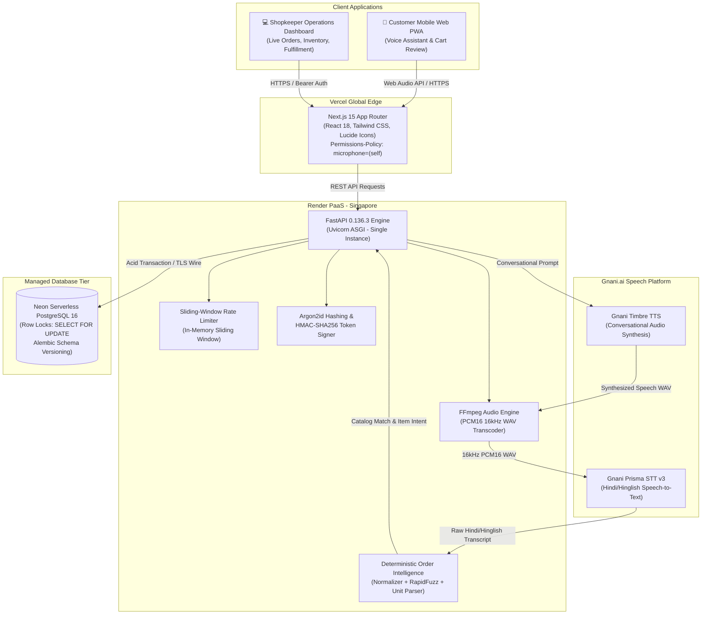
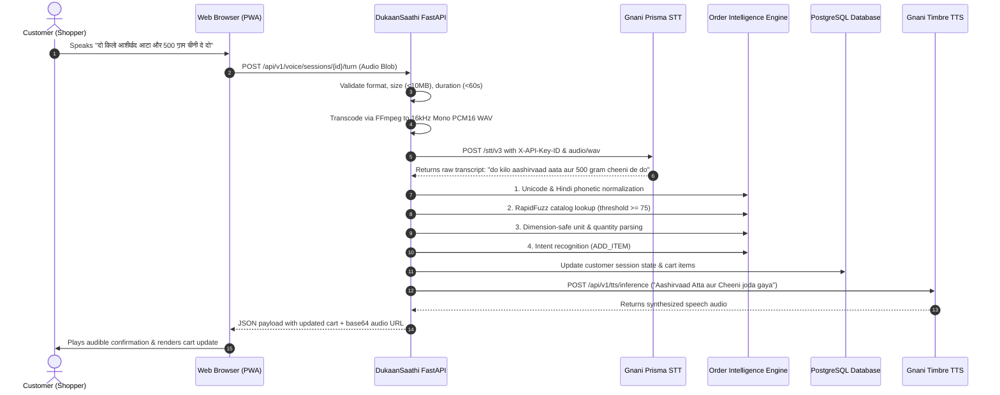

# DukaanSaathi (दुकान साथी)
### AI-Powered Voice Commerce Platform for Indian Neighbourhood Kirana Stores

[](file:///c:/Users/hiten/Downloads/gnani/docs/RELEASE_MANIFEST.md)
[](https://www.python.org/)
[](https://fastapi.tiangolo.com/)
[](https://nextjs.org/)
[](https://www.postgresql.org/)
[]()

DukaanSaathi bridges the digital divide for neighbourhood grocery stores (*kirana dukaans*) across India. By combining live Indian-language speech recognition, deterministic order intelligence, and a two-phase transactional inventory lifecycle, DukaanSaathi enables natural Hindi, Hinglish, and English voice ordering with zero inventory slippage.

---

## 1. System Architecture



---

## 2. Core Voice Pipeline & Intelligence Engine

DukaanSaathi does not feed raw user speech directly to an unconstrained LLM for order placement. Instead, it utilizes a 7-stage deterministic intelligence pipeline:



---

## 3. Critical Business Invariants

1. **Two-Phase Confirmation & Zero-Deduction Invariant:**
   - When a customer submits an order, it is placed in `status = 'pending'`.
   - **Zero inventory is deducted** upon order creation.
   - Inventory is deducted **only** when the shopkeeper explicitly clicks **Accept Order** in the merchant dashboard.
   - The deduction occurs inside an atomic transaction using row-level locking (`SELECT stock_level FROM inventory WHERE product_id = :id FOR UPDATE`), preventing race conditions or phantom stock decrements.
2. **Dimension-Safe Unit Handling:**
   - Weight units (`kg`, `g`) and volume units (`l`, `ml`) are dimension-isolated. The engine strictly forbids converting volume to weight.
   - Package-based items (`packet`, `piece`) cannot be sold in fractional units unless expressly supported by the product package metadata.
3. **Ambiguity Gate:**
   - If two products have similar matching confidence within a tight margin (e.g. *Fortune Sunlite Oil 1L* vs *Fortune Mustard Oil 1L*), the system marks the item as `needs_clarification` and speaks a targeted question rather than guessing.

---

## 4. Quickstart & Local Setup

### Prerequisites
- **Python:** Version 3.11 or higher
- **Node.js:** Version 18.18 or higher (with npm)
- **FFmpeg:** Installed and present in system `PATH`
- **PostgreSQL:** Version 16 (or local SQLite fallback for dev)

### 4.1 Automated Docker Stack (Recommended)
Launch the complete containerized stack (FastAPI backend + PostgreSQL 16) with persistent database volume:

```bash
# Clone the repository
git clone https://github.com/dukaansaathi/dukaansaathi.git
cd gnani

# Launch multi-container stack
docker compose up --build
```
- Backend API will be available at: `http://localhost:8000`
- API Documentation (Swagger): `http://localhost:8000/docs`
- PostgreSQL Database: `localhost:5432`

---

### 4.2 Manual Local Development Setup

#### Backend Setup
```bash
# 1. Create and activate virtual environment
python -m venv venv
# On Windows:
.\venv\Scripts\activate
# On Linux/macOS:
source venv/bin/activate

# 2. Install pinned dependencies
pip install -r requirements.txt

# 3. Configure environment variables
cp .env.example .env

# 4. Run database migrations and seed starter catalogue
alembic -c backend/alembic.ini upgrade head
python backend/scripts/validate_catalogue.py

# 5. Start development ASGI server
uvicorn backend.app.main:app --reload --port 8000
```

#### Frontend Setup
```bash
# In a separate terminal:
cd frontend

# 1. Install Node dependencies
npm install

# 2. Configure frontend environment
cp .env.example .env.local

# 3. Start Next.js development server
npm run dev
```
- Open `http://localhost:3000` for the Customer Voice Commerce App.
- Open `http://localhost:3000/merchant/login` for the Shopkeeper Operations Portal.

---

## 5. Environment Variables Reference

| Variable Name | Environments | Default Value | Description & Sensitivity |
| :--- | :--- | :--- | :--- |
| `APP_ENV` | All | `development` | Runtime environment (`development`, `staging`, `production`). Staging & production enforce strict secret validation. |
| `DATABASE_URL` | All | `sqlite:///./data/database/...` | Authoritative DB connection string. **Strictly requires `postgresql://` in staging/production.** |
| `SECRET_KEY` | All | `dukaansaathi-production...` | Cryptographic HMAC-SHA256 session token signing secret. **Must be >= 32 chars in production.** |
| `SHOPKEEPER_AUTH_TOKEN` | All | `demo-shopkeeper-secret...` | Bearer token for automated merchant administration. **Must be non-default in production.** |
| `MERCHANT_USERNAME` | All | `sharma` | Default store operator username. |
| `MERCHANT_PASSWORD` | All | `kirana@2026` | Default store operator password (hashed via Argon2id). |
| `ALLOWED_ORIGINS` | All | `http://localhost:3000` | Comma-separated or JSON list of CORS authorized web domains. |
| `GNANI_API_KEY` | All | `None` (Mock fallback) | Production API Key for live Gnani.ai Prisma STT & Timbre TTS engines. |
| `NEXT_PUBLIC_API_BASE_URL` | Frontend | `http://127.0.0.1:8000` | Base URL for FastAPI backend API calls. **Publicly visible in browser.** |
| `NEXT_PUBLIC_STORE_ID` | Frontend | `STORE001` | Active kirana store identifier. **Publicly visible in browser.** |

> [!WARNING]
> **No Server Secrets in Frontend:** Never prefix server-side credentials (`GNANI_API_KEY`, `SECRET_KEY`, `SHOPKEEPER_AUTH_TOKEN`) with `NEXT_PUBLIC_`. The Next.js frontend is strictly decoupled and receives session state via authenticated backend tokens.

---

## 6. Key API Endpoints

### Health Probes
- `GET /health/live`: Fast liveness check for container orchestrators (returns `{"status": "alive"}`).
- `GET /health/ready`: Deep dependency readiness check verifying PostgreSQL database connectivity and catalogue availability.

### Customer Voice Commerce
- `POST /api/v1/sessions`: Initialize or resume an ordering session for a store.
- `GET /api/v1/sessions/{id}`: Retrieve active session state, transcripts, and cart.
- `POST /api/v1/voice/sessions/{id}/turn`: Upload user voice audio; triggers transcode, STT, intelligence matching, cart mutation, and returns synthesized TTS response audio.
- `POST /api/v1/orders`: Finalize cart and place a pending customer order (**0 inventory deducted**).

### Merchant Operations (Protected)
- `POST /api/v1/auth/login`: Authenticate shopkeeper with username & password; returns secure session token.
- `GET /api/v1/auth/me`: Validate merchant authentication state.
- `GET /api/v1/merchant/overview`: Real-time operational metrics (Pending orders, today's revenue, low stock count).
- `GET /api/v1/orders`: Filter and list store orders (`pending`, `accepted`, `ready`, etc.).
- `POST /api/v1/orders/{id}/accept`: Atomically lock inventory rows and deduct stock (`SELECT ... FOR UPDATE`).
- `POST /api/v1/orders/{id}/reject`: Reject pending order with reason; zero inventory impact.
- `POST /api/v1/orders/{id}/status`: Progress order status (`preparing` $\rightarrow$ `ready` $\rightarrow$ `completed`).
- `GET /api/v1/inventory`: Retrieve live store stock levels and low-stock alerts.
- `PUT /api/v1/inventory/{product_id}`: Adjust inventory count with automated audit log movement.

---

## 7. Testing & Verification

The DukaanSaathi codebase is backed by **179 automated tests** covering 100% of P0 functional, security, and integration requirements:

```bash
# Run all Python backend, intelligence, voice, and integration tests
pytest tests/backend tests/intelligence tests/voice tests/integration -v

# Run Python security hardening & config validation tests
pytest tests/backend/test_security_hardening.py tests/backend/test_production_config_validation.py -v

# Run Frontend Vitest component and hook tests
cd frontend && npm run test

# Run Next.js production build check
cd frontend && npm run build
```

---

## 8. Demo Credentials & Test Accounts

| Role | Username | Password | Bearer Token | Active Store |
| :--- | :--- | :--- | :--- | :--- |
| **Merchant Admin** | `sharma` | `kirana@2026` | `demo-shopkeeper-secret-key-sharma-store` | `STORE001` (Sharma Kirana Store) |
| **Shopper** | *Anonymous* | *N/A* | *Automatic Session ID* | `STORE001` |

---

## 9. Synthetic Catalogue Disclosure

The product catalogue (`data/starter_pack_100.json`) contains **100 synthetic everyday Indian grocery items** spanning 8 essential categories (Staples, Dairy, Beverages, Snacks, Spices, Personal Care, Household, Packaged Foods). All names, barcodes, prices, aliases, and phone numbers are generated exclusively for testing and validation purposes. No real retail or consumer personal data is stored or processed.

---

## 10. Deployment Topology

- **Backend:** Render Web Service via Docker (`render.yaml`), Singapore region, Single Instance (`numInstances: 1`).
- **Frontend:** Vercel Global Edge (`frontend/vercel.json`), Next.js App Router, strict CSP and Permissions-Policy.
- **Database:** Neon Serverless PostgreSQL 16 with automatic daily backups and Point-In-Time-Recovery (PITR).

