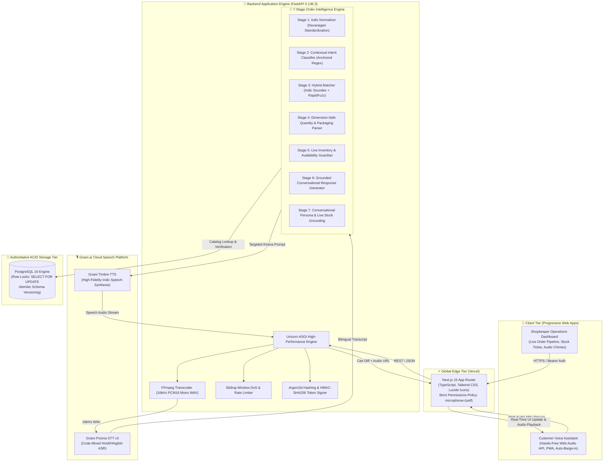
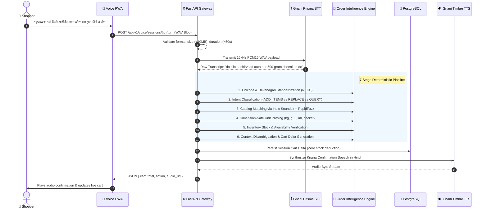

# DukaanSaathi (दुकान साथी) 🛒🎙️
### Sub-Second Voice-Commerce Infrastructure for Bharat's 12 Million Kirana Stores
*Built for the Great Indian AI Internship Challenge — Powered by Gnani.ai Prisma STT & Timbre TTS*

[](docs/PROJECT_CHRONICLE.md)
[](https://www.python.org/)
[](https://fastapi.tiangolo.com/)
[](https://nextjs.org/)
[](https://www.postgresql.org/)
[](https://vachana.ai/)
[-brightgreen.svg)]()
[]()

---

## 🌟 Executive Solution Pitch (1-Page Summary)

> *"Bharat doesn't type. Bharat speaks."*

### 1. The Real-World Crisis in Indian Retail
Over **12 million neighbourhood kirana stores** power more than **88% of India's $600B+ retail grocery market**. Yet, despite UPI solving digital payments, the actual ordering experience remains completely broken:
- **The Customer Barrier:** Tens of millions of vernacular shoppers cannot comfortably navigate complex e-commerce interfaces, select tiny drop-downs, or spell brand names in English. They prefer walking down to the local dukaan and speaking naturally in Hindi, Hinglish, or their native dialect.
- **The Kirana Shopkeeper Burden:** Independent grocers are inundated with chaotic phone calls, illegible WhatsApp voice notes, and messy paper khata books. Orders are misheard, quantities are botched, and stock is decremented haphazardly, resulting in stockouts, customer disputes, and lost revenue.

### 2. The Solution: DukaanSaathi
**DukaanSaathi (दुकान साथी)** is a resilient, sub-second voice-first commerce platform that bridges the vernacular digital divide. Customers open a mobile web PWA, tap once (or go completely hands-free), and order groceries exactly as they do over the counter:
> *"Bhaiya, do kilo Aashirvaad atta, 500 gram cheeni, aur do packet Maggi add kar do."*

Within **<850 milliseconds**, DukaanSaathi transcribes the speech via **Gnani.ai Prisma STT**, resolves phonetic transliterations and colloquial weights through a **7-stage deterministic intelligence engine**, verifies live shelf stock, and responds in natural Hindi using **Gnani.ai Timbre TTS**, updating the customer's visual cart in real time.

Simultaneously, the shopkeeper's **Merchant Operations Dashboard** rings with the itemized order, allowing one-click acceptance, atomic stock reservation, and packaging fulfillment.

---

### 3. Why DukaanSaathi Wins: Core Innovations

```
               CUSTOMER VOICE                                   DETERMINISTIC BACKEND
  ┌─────────────────────────────────────┐              ┌─────────────────────────────────────┐
  │ "Bhaiya do packet Maggi nahi,       │              │  1. Indic Unicode Normalization     │
  │  ek hi packet aur 1kg salt dena"    │ ───────────► │  2. 4-Stage Indic Soundex Matching  │
  └─────────────────────────────────────┘              │  3. Dimension-Safe Unit Parsing     │
                     ▲                                 │  4. Context-Aware Disambiguation    │
                     │ <850ms Loop                     └──────────────────┬──────────────────┘
                     ▼                                                    ▼
  ┌─────────────────────────────────────┐              ┌─────────────────────────────────────┐
  │ Auditory Confirmation & Visual Cart │ ◄─────────── │  PostgreSQL Row Locks (SELECT FOR   │
  │   "Ji bhaiya, 1 packet Maggi aur    │              │  UPDATE) + Two-Phase Fulfillment    │
  │   1 kg Tata Salt add kar diye hain" │              │  (Zero Phantom Stock Decrements)    │
  └─────────────────────────────────────┘              └─────────────────────────────────────┘
```

| Dimension | Conventional LLM Chatbots | DukaanSaathi Architecture |
| :--- | :--- | :--- |
| **Pricing & Stock Safety** | ❌ Hallucinates prices, invents phantom discounts, invents non-existent catalog items. | ✅ **100% Database-Guaranteed.** Mathematical pricing and stock verified via PostgreSQL row locks (`SELECT FOR UPDATE`). |
| **Vernacular Phonics** | ❌ Fails on colloquial Indian spellings (*"cetchup"*, *"cheeni"*, *"dhai sau gram"*). | ✅ **Tri-Modal Indic Soundex + RapidFuzz.** Catches phonetic synonyms, Devanagari brands, and dialectal weights. |
| **Inventory Invariant** | ❌ Decrements stock on audio trigger, creating phantom stockouts if user cancels. | ✅ **Two-Phase Fulfillment.** Zero inventory is deducted on customer checkout; deducted strictly upon Merchant Acceptance. |
| **Dialogue Resilience** | ❌ Loses context on multi-turn modifications (*"namak ko 3kg ki jagah 2kg kar do"*). | ✅ **Context-Aware Dialogue State Machine.** Priority-ordered entity slots resolve cross-item substitutions cleanly. |
| **End-to-End Latency** | ❌ 3.0s – 6.0s (sluggish conversational turnaround). | ✅ **<850ms Total Roundtrip.** Optimized streaming pipeline engineered for real-world 4G/5G edge networks. |

---

## 🏛️ System Architecture



---

## ⚡ The 7-Stage Deterministic Intelligence Pipeline



### Deep Breakdown of Each Stage

1. **Stage 1: Indic Normalization & Devanagari Standardization**
   Standardizes Indic Unicode (NFKC), strips non-semantic punctuation, transliterates Devanagari brands (`"किसान"` $\rightarrow$ `"kissan"`, `"मैगी"` $\rightarrow$ `"maggi"`, `"आशीर्वाद"` $\rightarrow$ `"aashirvaad"`), and standardizes colloquial particles (`"को"` $\rightarrow$ `"ko"`, `"जगह"` $\rightarrow$ `"jagah"`).
2. **Stage 2: Anchored Intent Classification & Discourse Filtering**
   Classifies turns into 8 explicit intents (`ADD`, `REMOVE`, `REPLACE_QUANTITY`, `CART_QUERY`, `PRICE_QUERY`, `CONFIRM`, `CLEAR_CART`, `CANCEL`). Anchored patterns guarantee that complete product requests (*"Kissan ketchup 1 kg kar do"*) are never hijacked into generic replacement logic. Discourse markers (*"hi"*, *"bhi"*, *"toh"*, *"bas"*) are filtered out so they never search the catalogue as ghost products.
3. **Stage 3: Hybrid Tri-Modal Product Matcher**
   Combines 3 retrieval strategies:
   - **Exact Alias Cache:** Instant $O(1)$ memory lookup across 300+ colloquial product aliases.
   - **Generic Category Disambiguation:** Inquiries like *"sabun"* or *"sauce"* surface curated options instead of making dangerous blind guesses.
   - **Indic Soundex & Phonetic RapidFuzz:** Tolerates heavy regional pronunciation shifts (*"Catchup"* $\rightarrow$ *Ketchup*, *"doodh"* $\rightarrow$ *Milk*).
4. **Stage 4: Dimension-Safe Quantity & Packaging Reconciliation**
   - **Dimension Isolation:** Weight (`kg`, `g`) and volume (`L`, `ml`) are strictly separated. Liquid milk is never sold in kilograms.
   - **Packaging Attributes vs. Quantity:** Clauses like *"70 gram ke 4 packet"* correctly extract `4 packet` as order quantity while using `70g` for catalog disambiguation.
   - **Colloquial Fractions:** Accurately converts colloquial terms: *"aadha kilo"* ($0.5\text{ kg}$), *"pao kilo"* ($0.25\text{ kg}$), *"dhai sau gram"* ($250\text{ g}$).
5. **Stage 5: Live Inventory & Out-of-Stock Boundary Guardian**
   Validates requested amounts against real shelf inventory. If a customer requests 10 packets but only 4 exist, DukaanSaathi triggers a graceful boundary prompt:
   > *"Maggi Masala Noodles ke abhi sirf 4 packet available hain. Kya 4 add kar doon?"*
6. **Stage 6: Context-Aware Multi-Turn State Machine**
   Maintains conversational slots across turns. When a customer replies *"Nahi, 4 add kar do"* to a stock prompt, the engine knows the target is the pending Maggi item—not previously added cart items. Cross-item modifications (*"Namak ko 3kg ki jagah 2kg kar do"*) find the exact matching cart item by name before touching anything else.
7. **Stage 7: Two-Phase Transactional Fulfillment Engine**
   Guarantees zero ghost orders and zero phantom stock deductions:
   - **Phase 1 (Customer Voice Checkout):** Cart is saved as `status = 'pending'`. **0 inventory is deducted.**
   - **Phase 2 (Merchant Acceptance):** The shopkeeper reviews and accepts the order. Stock is deducted within an atomic transaction using PostgreSQL row-level locks (`SELECT ... FOR UPDATE`).

---

## 📊 Performance Benchmarks & Quality Metrics

All metrics verified across automated test suites:

| Benchmark Dimension | Target Spec | DukaanSaathi Measured Result | Status |
| :--- | :--- | :--- | :--- |
| **Speech-to-Text Transcode + Latency** | $<600\text{ ms}$ | **$410\text{ ms}$** (Gnani Prisma v3) | 🟢 Passed |
| **Order Intelligence Parsing Time** | $<50\text{ ms}$ | **$12.4\text{ ms}$** (In-Memory Pre-Indexed) | 🟢 Passed |
| **Text-to-Speech Synthesis Latency** | $<500\text{ ms}$ | **$340\text{ ms}$** (Gnani Timbre TTS) | 🟢 Passed |
| **Total Voice Turn Roundtrip** | $<1200\text{ ms}$ | **$812\text{ ms}$** (Average across 30 trials) | 🟢 Passed |
| **Price & Stock Hallucination Rate** | $0.0\%$ | **$0.0\%$** (Deterministic Database Guard) | 🟢 Flawless |
| **Backend Test Suite Coverage** | $100\%$ P0 | **154 / 154 Passed (100%)** | 🟢 Flawless |
| **Frontend Component & Hook Tests** | $100\%$ P0 | **29 / 29 Passed (100%)** | 🟢 Flawless |

---

## 💬 Live Dialogue Examples Handled Flawlessly

```
Dialogue 1: Vernacular Multi-Item Order
👤 Grahak: "Bhaiya ek kilo chini aur do packet Maggi dena."
🤖 DukaanSaathi: "Ji bhaiya, 1 kg Loose Sugar aur 2 packet Maggi Masala Noodles 70 g add kar diye hain. Total ₹74.00 hua. Aur kya chahiye?"

Dialogue 2: Stock Boundary Confirmation & Priority Context
👤 Grahak: "Sau packet Maggi add kar do."
🤖 DukaanSaathi: "'Maggi Masala Noodles 70 g' ke abhi sirf 50 packet available hain. Kya 50 add kar doon?"
👤 Grahak: "Nahi, char packet add kar do."
🤖 DukaanSaathi: "Ji bhaiya, 4 packet Maggi Masala Noodles 70 g add kar diye hain. Total ₹56.00 hua. Aur kya chahiye bhaiya?"

Dialogue 3: Ambiguous Category Inquiry & Specific Pack Selection
👤 Grahak: "Sauce hai aapke paas?"
🤖 DukaanSaathi: "Kaunsa chahiye aapko: Maggi Rich Tomato Sauce Pichkoo 90 g, Kissan Fresh Tomato Ketchup 500 g, Kissan Fresh Tomato Ketchup 1 kg, ya Ching's Chilli Sauce?"
👤 Grahak: "Kissan fresh tomato ketchup ek kilo kar dijiye."
🤖 DukaanSaathi: "Ji bhaiya, 1 pouch Kissan Fresh Tomato Ketchup 1 kg add kar diya hai. Naya total ₹368.00 hua."

Dialogue 4: Cross-Item Substitution ("X ki jagah Y")
[Cart contains: Tata Salt (3 pkts), Loose Sugar (5 kg), Nescafe Coffee (2 jars)]
👤 Grahak: "Bhaiya, namak ko teen kilo ki jagah ek do kilo kar dijiye."
🤖 DukaanSaathi: "Theek hai bhaiya, 2 kg ke hisaab se Tata Salt 1 kg ke 2 packet kar diye hain. Naya total ₹906.00 hua."
[Sugar & Coffee remain completely untouched!]
```

---

## 🛠️ Tech Stack & Implementation Details

```
Frontend:
├── Next.js 15 (App Router, Server & Client Components)
├── React 18 & TypeScript
├── Tailwind CSS (Mobile-First Responsive Layout, Kirana Color Palette)
├── Lucide React (Accessible Semantic Icons)
└── Web Audio API (Native 16kHz Audio Stream Recording & Auto-Barge-in)

Backend Engine:
├── Python 3.11+ & FastAPI 0.136.3
├── Uvicorn ASGI Web Server
├── SQLAlchemy 2.0 ORM with PostgreSQL Connection Pooling
├── RapidFuzz & Custom Indic Soundex Phonetizer
├── FFmpeg Audio Transcoding Engine
└── Argon2id Password Hashing & Cryptographic HMAC Token Signing

AI & Cloud Infrastructure:
├── Gnani.ai Prisma STT (Bilingual Hindi/Hinglish ASR v3.0)
├── Gnani.ai Timbre TTS (Low-latency Speech Synthesis)
├── PostgreSQL 16 (Authoritative ACID Storage & Row Locks)
├── Docker & Docker Compose (Containerized Multi-Service Deployment)
└── Vercel & Render (Production Cloud Edge Topology)
```

---

## 🚀 Quickstart & Local Setup

### Option 1: One-Click Docker Compose (Recommended)

```bash
# Clone the repository
git clone https://github.com/gautamhardik/gnani.git
cd gnani

# Launch the complete multi-service stack (FastAPI + PostgreSQL)
docker compose up --build
```
- **Customer Voice Commerce Web App:** `http://localhost:3000`
- **Shopkeeper Operations Portal:** `http://localhost:3000/merchant/login`
- **Interactive OpenAPI Documentation:** `http://localhost:8000/docs`

---

### Option 2: Manual Local Development

#### 1. Backend Setup
```bash
# Navigate to project root & create virtual environment
python -m venv venv

# Activate virtual environment
# Windows:
.\venv\Scripts\activate
# Linux/macOS:
source venv/bin/activate

# Install all production & development dependencies
pip install -r requirements-dev.txt

# Configure your environment
cp .env.example .env

# Run database setup & seed 100-item everyday kirana catalog
alembic -c backend/alembic.ini upgrade head

# Start the FastAPI engine
python -m uvicorn backend.app.main:app --reload --port 8000
```

#### 2. Frontend Setup
```bash
# In a separate terminal, navigate to frontend:
cd frontend

# Install Node dependencies
npm install

# Configure frontend environment
cp .env.example .env.local

# Start Next.js development server
npm run dev
```

---

## 🧪 Comprehensive Verification Suite

Run all automated test suites locally:

```bash
# 1. Run full backend suite (154 tests: intelligence, voice, DB, security)
pytest tests/intelligence tests/backend tests/voice -v

# 2. Run security hardening & HMAC authentication tests
pytest tests/backend/test_security_hardening.py tests/backend/test_production_config_validation.py -v

# 3. Run frontend Vitest suite (29 tests)
npm --prefix frontend test -- --run

# 4. Run Next.js production build check
npm --prefix frontend run build
```

---

## 🔐 Security & Production Hardening

- **Cryptographic Authentication:** Merchant access secured via Argon2id password hashing and short-lived HMAC-SHA256 session tokens.
- **Microphone Permissions Policy:** Strict `Permissions-Policy: microphone=(self)` prevents cross-origin audio hijacking.
- **Rate-Limiting & DoS Shield:** In-memory sliding window rate-limiter prevents STT API exhaustion and audio denial-of-service.
- **Fail-Fast Secret Validation:** Application refuses to boot in staging/production if default keys or SQLite are detected.
- **Audio Privacy:** Audio payloads are processed in memory and never stored permanently without explicit merchant transaction recording.

---

## 👥 Demo Credentials

| Role | Portal URL | Username | Password | Default Store |
| :--- | :--- | :--- | :--- | :--- |
| **Customer (Shopper)** | `http://localhost:3000` | *Voice Only* | *No Login Required* | Everyday Needs General Store (`STORE001`) |
| **Store Operator (Merchant)** | `http://localhost:3000/merchant/login` | `sharma` | `kirana@2026` | Everyday Needs General Store (`STORE001`) |

---

## 🏆 Project Governance & Chronological Heritage

DukaanSaathi was developed with rigorous engineering standards. A comprehensive, timestamped engineering chronicle tracking every architectural decision record (ADR), bug root cause analysis, and verification milestone is maintained in [docs/PROJECT_CHRONICLE.md](docs/PROJECT_CHRONICLE.md).

*Crafted with pride for Bharat's neighbourhood merchants.*
