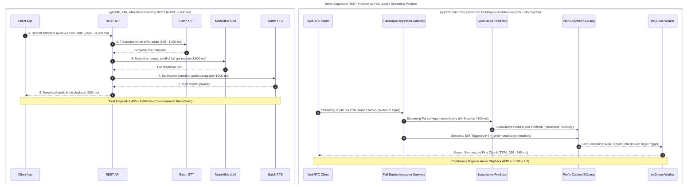
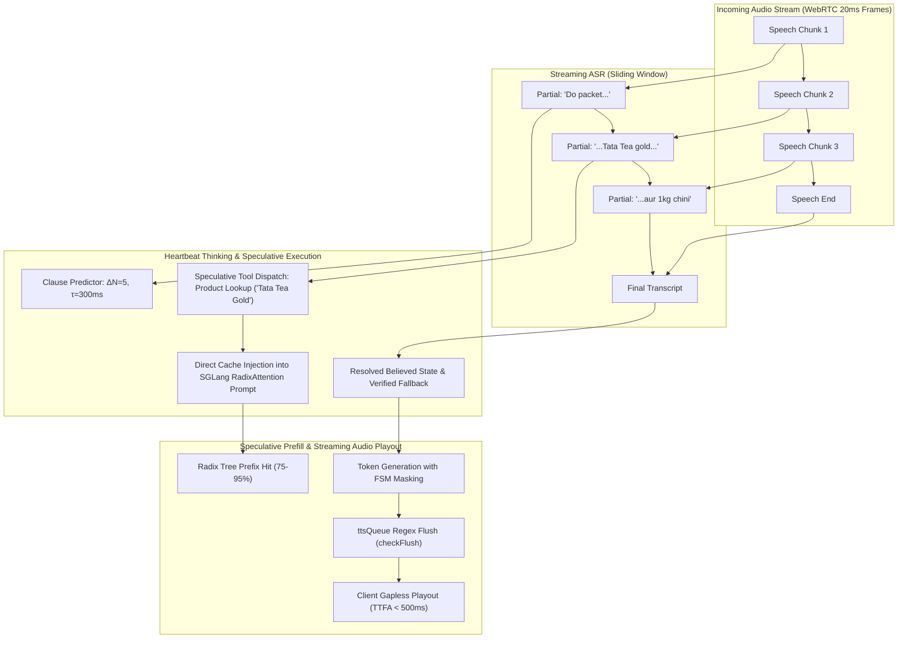
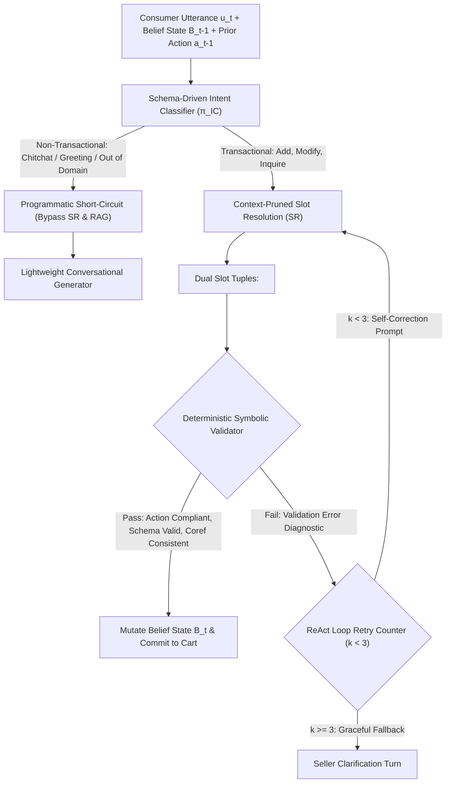
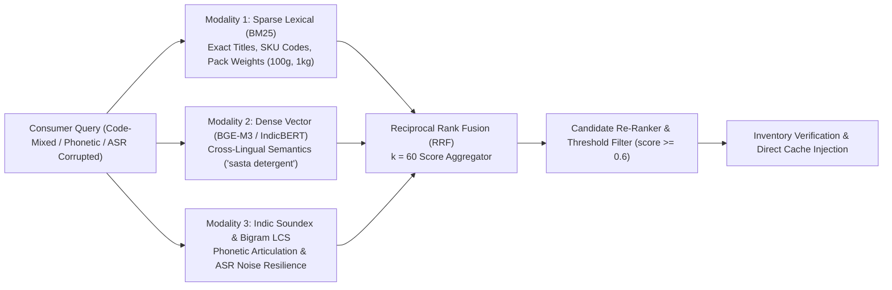
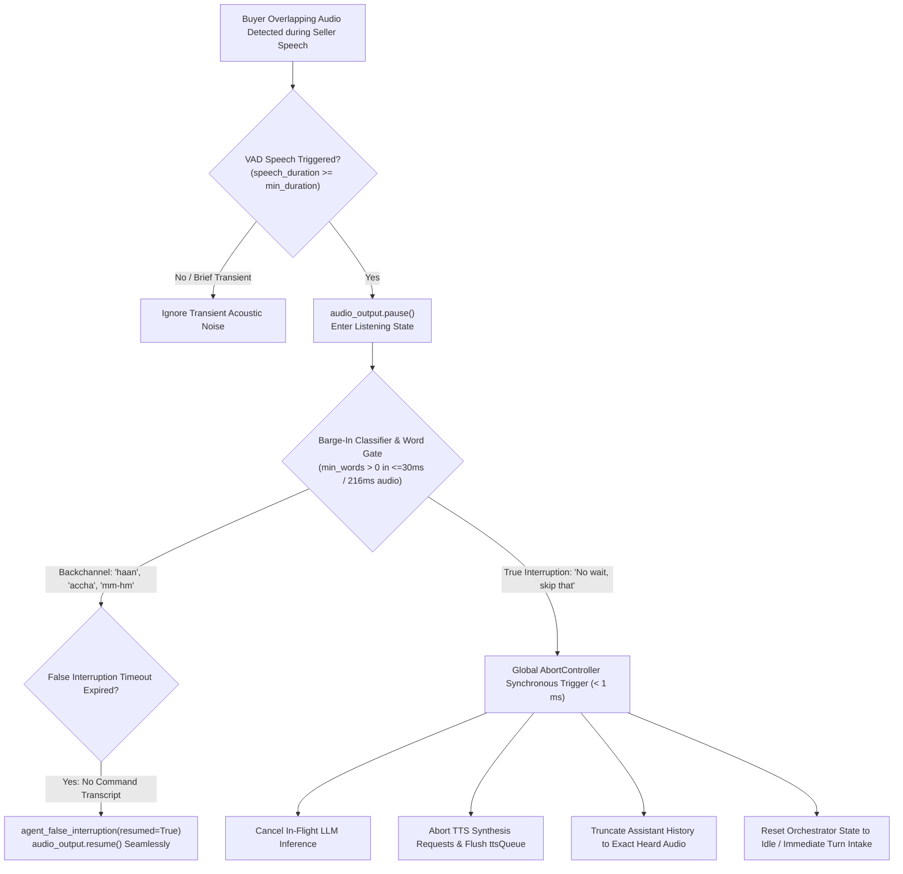

# Architectural Blueprint for Sub-Second, Agentic Conversational Commerce Systems

## Executive Architectural Synthesis: From Sequential Chatbots to Full-Duplex Agentic Commerce

Transitioning a transactional chatbot from a brittle, turn-based question-answering utility into an efficient, autonomous, and natural consumer-seller dialogue partner requires a fundamental overhaul of its transport, inference, retrieval, and state-tracking layers. In human commercial interactions—such as a buyer negotiating product availability, pack sizes, or substitutions with a seasoned merchant—the biological expectation for turn-taking gap latency averages **200 to 250 milliseconds**. When system response latency exceeds **500 milliseconds**, consumers subconsciously perceive hesitation or evasiveness; once delays surpass **800 to 1,500 milliseconds**, conversational flow fractures, causing users to repeat themselves, talk over the delayed response, or abandon the transaction entirely.

```
Conversational Latency Thresholds & Perceived Naturalness:

  0 ms        200-250 ms              500 ms                   800 ms               1,500 ms+
  ├───────────────┼───────────────────────┼───────────────────────┼───────────────────────┤
  │ Human-Grade   │ Ideal Conversational  │ Subconscious Friction │ Flow Fractures;       │ Abandonment &
  │ Reflex Target │ Turn-Taking Window    │ (Perceived Hesitation)│ Over-talking & Repeats│ Breakdown
```

Legacy chatbot architectures fail to meet this threshold because they treat audio, text, retrieval, and tool execution as discrete, blocking payloads over sequential REST APIs. In a naive blocking pipeline, recording a complete user utterance, uploading the payload, running batch transcription, executing retrieval and language model computation, and synthesizing the full response results in an end-to-end turnaround of **6,400 to 8,600 milliseconds**. Furthermore, standard single-pass Large Language Model (LLM) prompts degrade under the linguistic complexity of real-world commerce, where buyers frequently use code-mixed language (such as Hinglish, Tanglish, or Banglish), phonetic spelling variations, implicit confirmations (*"haan, wohi de do"* or *"yes, give me that one"*), and mid-sentence revisions.



To achieve sub-second responsiveness, deterministic transactional accuracy, high-recall Retrieval-Augmented Generation (RAG), and lifelike consumer-seller rapport, the system architecture must evolve across **four interdependent dimensions**:

1. **Fast Replies via Asynchronous Streaming and Speculative Execution:**
   Replace blocking request-response cycles with persistent full-duplex WebSockets or WebRTC streams, overlap partial Speech-to-Text (STT) hypotheses with speculative LLM prefill and parallel tool prefetching ("Heartbeat Thinking"), and deploy prefix-caching inference engines (SGLang RadixAttention) alongside bilingual semantic Text-to-Speech (TTS) chunking.
2. **Proper Replies via Bounded Neuro-Symbolic State Tracking and Constrained Decoding:**
   Decouple Natural Language Understanding (NLU) from monolithic prompt generation by implementing a constrained ReAct state machine (ReacTOD) gated by a deterministic symbolic validator, augmented with binary accountability heads for confidence-calibrated conversational repair and Finite-State Machine (FSM) grammar-guided decoding.
3. **Proper RAG Usage via Tri-Modal Hybrid and Phonetic Retrieval:**
   Overcome lexical mismatches and Automatic Speech Recognition (ASR) transcription noise in product catalogs by fusing sparse lexical matching (BM25), multilingual dense vector embeddings (BGE-M3 and IndicBERT), and domain-tuned phonetic encoding (Indic Soundex with bigram edit distance) via Reciprocal Rank Fusion (RRF), coupled with direct prompt cache injection during active user speech.
4. **Replicating Natural Consumer-Seller Dialogue via Multimodal Turn Detection, Adaptive Barge-In, and Persona Calibration:**
   Combine Voice Activity Detection (VAD) with semantic and prosodic End-of-Turn (EoT) models to eliminate premature cutoffs during buyer pauses, implement sub-millisecond `AbortController` barge-in loops that distinguish conversational backchanneling from true interruptions, and utilize intent-routed filler phrases and native-script transliteration for authentic merchant prosody.

---

## 1. Engineering Sub-Second Responsiveness: Latency Budgets, Speculative Execution, and Serving Infrastructure

### 1.1 Deconstructing the End-to-End Conversational Latency Budget

Achieving human-grade conversational pacing requires managing **Voice-to-Voice Latency**—defined as the elapsed time between the final acoustic frame of the consumer's utterance and the first audible frame of the seller agent's reply, also measured as **Time-to-First-Audio (TTFA)**. Because STT finalization, LLM Time-to-First-Token (TTFT), and TTS synthesis compound sequentially in a standard cascade, acceptable median metrics at individual stages frequently sum to a broken user experience. Moreover, engineering teams must optimize against 50th percentile (p50) and 95th or 99th percentile (p95/p99) tail latencies rather than statistical means, as tail spikes in one out of twenty turns destroy perceived seller reliability.

| Pipeline Stage | Naive Blocking REST Architecture | Optimized Streaming Pipeline (p50) | Optimized Streaming Pipeline (p95 / Upper Bound) | Primary Architectural Bottleneck & Mitigation |
| :--- | :--- | :--- | :--- | :--- |
| **Audio Capture & Endpointing** | 2,500 – 4,000 ms (Full WAV capture) | 40 – 120 ms (20–40 ms PCM frames) | 150 – 400+ ms (Silence threshold wait) | VAD silence confirmation delay; mitigated via semantic EoT & speculative prefill. |
| **Network Transport** | 300 – 600 ms (HTTP POST upload) | 15 – 60 ms (Persistent WebSocket/WebRTC) | 80 – 160 ms (Multi-hop / jitter buffer) | TCP head-of-line blocking on mobile networks; mitigated via WebRTC UDP transport. |
| **Speech-to-Text (STT)** | 800 – 1,200 ms (Batch transcription) | 60 – 100 ms (Streaming partial commit) | 150 ms (Finalization lag) | Waiting for end-of-utterance; mitigated by forwarding incremental partials downstream. |
| **LLM Inference (TTFT)** | 1,500 ms (Full text completion) | 120 – 250 ms (Quantized local / prefix hit) | 600 – 820 ms (Cloud API / cold prefill) | Compute-bound prompt prefill; mitigated via SGLang RadixAttention & FP8/INT4 weights. |
| **Text-to-Speech (TTS TTFA)** | 1,000 ms (Full paragraph MP3 synthesis) | 80 – 110 ms (First clause chunk stream) | 220 ms (Complex prosody / cold start) | Waiting for complete LLM sentences; mitigated via $O(1)$ regex clause flushing. |
| **Client Playback Buffering** | 300 ms (File download & player init) | 20 – 80 ms (Gapless PCM queue) | 150 ms (Client jitter buffer) | Audio starvation mid-turn; mitigated by keeping synthesis RTF $< 1.0$. |
| **Total Turnaround (TTFA)** | **6,400 – 8,600 ms (Unusable)** | **395 – 545 ms (Human-Grade)** | **800 – 1,360 ms (Acceptable Ceiling)** | **Overlapping stages recovers the majority of sequential latency.** |

As the latency distribution indicates, two components dominate the non-overlapping critical path: endpointing delay (waiting 150 to 400+ ms of silence to confirm the buyer has finished speaking) and LLM Time-to-First-Token (which averages 820 ms at p50 on remote cloud endpoints like GPT-4o, consuming nearly the entire one-second naturalness budget by itself).

Furthermore, transport architecture dictates resilience under real-world mobile connectivity: while WebSockets (built over TCP) are well-suited for server-to-server communication inside a datacenter, TCP enforces strict packet ordering. On a buyer's volatile mobile network, a single dropped 20 ms audio frame triggers TCP head-of-line blocking, stalling the stream for 500 ms. Consequently, production voice-enabled commerce systems should utilize **WebRTC** (over UDP with the Opus codec at 16 kHz and 16 to 32 kbps) between the client application and the ingestion gateway, while maintaining persistent internal WebSockets or gRPC streams between the orchestrator, STT, LLM, and TTS microservices.

---

### 1.2 Hiding Latency via Speculative Execution and Heartbeat Thinking

To eliminate the sequential wait between speech completion, tool execution, and response generation, the architecture must shift from a reactive cascade to anticipatory speculative execution. Because streaming STT models operate on sliding windows of a few hundred milliseconds, most of a consumer's sentence is already transcribed by the time the final word is spoken. Forwarding stable partial transcripts to the LLM and tool predictor hides both the STT endpointing delay and external database lookup latency behind the user's ongoing speaking time.



Implementing speculative execution over streaming speech requires solving two structural challenges:
1. **Backward language resolution in partial transcripts**: Spoken language resolves backward—homophones (`/tu:/` resolving to *to*, *too*, or *two*), numbers (*"fifteen"* becoming *"fifteen hundred"*), and word boundaries (*"ice cream"* versus *"I scream"*) shift as subsequent audio arrives. Consequently, partial STT outputs cannot be treated as an append-only log; they must be managed as a frozen prefix plus a replaceable provisional tail. In the orchestration layer, a `SpeculativeTurnTracker` must version each conversational turn as a tuple of `(turn_id, turn_revision)`. When a partial transcript stabilizes (or when an end-of-turn anticipation model fires prior to acoustic silence), the orchestrator launches a speculative LLM prefill and tool-selection pass tagged with the current `turn_revision`. Every downstream handler gates on `is_latest`; if subsequent words spoken by the buyer alter the transcript beyond the provisional tail, the turn reopens as a new revision, and outputs from the superseded revision are discarded before reaching the audio output gate.
2. **Argument truncation during mid-utterance updates**: For agentic tool calls—such as querying grocery inventory, checking order status, or calculating bulk pricing—waiting until the user finishes speaking leaves the user staring at silence while remote APIs execute. Two complementary speculative paradigms solve this problem:
   - **Clause-Segmented Predictor with Direct Cache Injection**: As streaming ASR emits partial words, a lightweight Predictor module evaluates the accumulated hypothesis after an initial threshold of $N$ words, re-evaluating after every $\Delta N = 5$ additional words or $\tau = 300\text{ ms}$. The predictor segments the partial hypothesis into non-overlapping clauses using coordinating conjunctions and discourse markers (such as *and*, *but*, *also*, *then*, and *while*). Likely high-latency tool calls (e.g., product catalog search or price lookup) are launched speculatively in the background while the consumer is still speaking, and their return payloads are stored in a *Speculative Results Cache*.
   - **Heartbeat Thinking for Stateful Multi-Tool Preparation**: Standard speculative frameworks struggle with complex multi-step dependencies because they either bound each generation episode to a fixed speech chunk (such as SHANKS, which frequently truncates a tool call before its JSON arguments are fully generated) or interrupt ongoing LLM generation whenever new ASR tokens arrive (such as SIA, which aborts in-flight tool calls before they can be dispatched). *Heartbeat Thinking* resolves this by decoupling ongoing tool preparation from incoming speech updates. During user speech, periodic "Thinker" invocations read the latest partial transcript alongside a shared, mutable record of completed deliberation and dispatched tool results. When new speech arrives, existing Thinker invocations and in-flight tool calls are allowed to finish rather than being aborted; subsequent heartbeat invocations inspect the completed outputs, resolve missing arguments, and initiate dependent tool calls.

Across complex multi-step benchmarks (such as FDBench v3), Heartbeat Thinking increases speculative tool coverage by **16 percentage points** and reduces mean final-response latency by **$36.4\%$**. Furthermore, empirical analyses of explicit user self-corrections during speech show that **$70.6\%$** of revised utterances contain a corrected tool call prior to speech end, enabling the final heartbeat pass to filter out superseded speculative results when a consumer adds a late constraint (e.g., adding a budget or brand restriction at the end of a sentence).

---

### 1.3 Inference Engine Optimization: RadixAttention, Scheduling, and Quantization

In an agentic consumer-seller chatbot, every conversational turn and internal ReAct step resends a substantial shared prefix: a 1,500-to-2,000-token seller system prompt, structured tool definitions, retrieved RAG product schemas, and the accumulating multi-turn dialogue history. During the prefill phase, the GPU is strictly compute-bound as it calculates self-attention across the entire input sequence in parallel; during the subsequent token decoding phase, the GPU becomes memory-bandwidth-bound as it repeatedly transfers model weights and Key-Value (KV) cache tensors from High Bandwidth Memory (HBM) to the streaming multiprocessors for every single generated token.

Deploying standard PyTorch or sequential serving wrappers (such as default Ollama configurations, which process requests sequentially at 510 ms TTFT and 160 tokens/sec) creates severe queuing stalls under concurrent traffic. Production deployments must pair **PagedAttention** (which eliminates contiguous KV cache memory fragmentation via non-contiguous logical blocks and copy-on-write block tables) with **RadixAttention** in SGLang.

```
SGLang RadixAttention Tree Walk:

                 [ Root: System Prompt (1,800 tokens) ]
                                   │
              ┌────────────────────┴────────────────────┐
      [ Session A: User Cart ]                  [ Session B: New Turn ]
              │                                         │
    [ Turn 1 + Tool Catalog ]                 [ Turn 1: Product Query ]
              │                                         │
      [ Turn 2 (Suffix) ]                       [ Turn 2 (Suffix) ]
       ▲ Only compute unmatched                 ▲ Only compute unmatched
         suffix forward pass                      suffix forward pass
```

While standard engines discard KV cache tensors once a request completes, SGLang's RadixAttention retains completed KV blocks in a global radix tree indexed by token sequence hashes. On every incoming turn or speculative heartbeat branch, SGLang performs a single tree walk to locate the longest matching prefix and computes transformer forward passes strictly on the unmatched suffix (the newest consumer utterance or tool response). In multi-turn agentic workloads, RadixAttention achieves **75% to 95% prefix cache hit rates**, delivering a **180 ms TTFT** and **2,850 tokens/sec throughput** (compared to 240 ms TTFT and 2,400 tokens/sec in vLLM v0.7).

For high-scale multi-tenant deployments where active session working sets exceed GPU VRAM, integrating **SGLang HiCache** or **SGLang-LSM** extends the radix tree across CPU host memory and NVMe SSDs using a "page-first" I/O layout and layer-wise compute-and-transfer overlapping (loading layer $N+1$ KV states concurrently while layer $N$ executes), boosting cache hit rates by up to **$143\%$** and cutting TTFT by up to **$24\%$**.

To further compress TTFT and Time-Per-Output-Token (TPOT) on self-hosted open-weight models (such as Llama-3.2-3B-Instruct for fast routing and slot extraction and Qwen-2.5-7B-Instruct or DeepSeek-R1-32B for seller synthesis), three engine-level optimizations are required:

1. **Chunked Prefill and Interleaved Decoding**: In concurrent serving, an incoming long prompt prefill pauses ongoing token decoding for neighboring active conversations—an interference effect where neighbor prefills account for 29% to 66% of total decode stall time at concurrency 16. Configuring `--max-num-batched-tokens 1024` in vLLM or SGLang cuts median TTFT by **$33\%$** (from $\sim 4,378\text{ ms}$ to $\sim 2,914\text{ ms}$ under heavy load), while tuning `decode_interleave_prefill_steps` balances first-token responsiveness against inter-token smoothness.
2. **Weight and KV Cache Quantization**: Lowering weight precision from FP32 (4 bytes/parameter, 28 GB for a 7B model) or BF16 (2 bytes/parameter, 14 GB) down to FP8 (on Hopper and Blackwell GPUs) or 4-bit AWQ and GGUF INT4 (0.5 bytes/parameter, 3.5 GB for 7B) halves or quarters the bytes read from HBM per decode step, effectively doubling memory bandwidth and cutting TPOT from 41–56 ms down to 17–23 ms on commodity GPUs. Quantizing the KV cache to FP8 simultaneously doubles the concurrent session capacity before Least-Recently-Used (LRU) radix tree eviction occurs.
3. **Speculative Decoding with Tiny Draft Models**: Enabling speculative decoding by pairing a target 70B or 32B seller model with a tiny draft model (such as Llama-3.2-3B speculating for Llama-3.3-70B) allows the engine to verify multiple drafted tokens in a single parallel forward pass, accelerating memory-bound decoding without sacrificing output fidelity.

---

### 1.4 Asynchronous TTS Streaming and Bilingual Semantic Chunking

Once the LLM begins emitting tokens, waiting for the full response before invoking TTS destroys the latency budget. Instead, the orchestrator must pipe tokens into an asynchronous First-In-First-Stream (`ttsQueue`) worker that dispatches semantic clauses to a streaming TTS engine (such as ElevenLabs Turbo v2.5, Deepgram Flux, Cartesia Sonic-3, or Sarvam Bulbul V4 Flash) while the LLM is still generating subsequent sentences.

Naive fixed-token buffering (flushing every $N$ tokens regardless of linguistic structure) splits words mid-phrase, causing unnatural prosodic stutters and raising mean Time-to-First-Byte (TTFB) to $6.5\text{ s}$. In bilingual or code-mixed consumer-seller environments (such as Hinglish, where Devanagari and Latin scripts interleave), the token stream callback should execute a deterministic, $O(1)$ regex boundary heuristic (`checkFlush()`) that evaluates three trigger classes in strict priority order:

1. **Indic and Native Morphology (Priority 1):** Detects the Devanagari single danda (`।`) or double danda (`॥`) marking hard syntactic sentence boundaries in Hindi/Sanskrit script.
2. **Latin Terminal Punctuation (Priority 2):** Checks for sentence-final `.`, `?`, or `!` appended to strings of three or more alphabetic characters, guarded by a curated abbreviation blocklist (`Mr.`, `Dr.`, `Rs.`, `kg.`, `pkt.`, etc.) to prevent premature mid-clause flushing.
3. **Structural Clause Delimiters (Priority 3):** Identifies explicit newlines (`\n`), em-dashes (`—`), and ellipses (`...`), which naturally delimit conversational clauses in merchant dialogue.

```python
# Deterministic O(1) Bilingual Boundary Flusher Pattern
ABBREVIATIONS = {"mr.", "dr.", "rs.", "kg.", "gm.", "pkt.", "ltr.", "approx.", "etc."}

def check_flush(buffer: str) -> bool:
    if len(buffer) < 30:  # Minimum clause length constraint
        return False
    if len(buffer) >= 220:  # Hard maximum ceiling to avoid run-on latency
        return True
    
    # Priority 1: Indic Danda Hard Sentence Boundary
    if re.search(r"[।॥]", buffer):
        return True
        
    # Priority 2: Latin Terminal Punctuation (guarded by abbreviations)
    match = re.search(r"(\b\w+[\.\?!])\s*$", buffer)
    if match:
        token = match.group(1).lower()
        if token not in ABBREVIATIONS:
            return True
            
    # Priority 3: Structural Delimiters
    if re.search(r"(\n|—|\.\.\.)", buffer):
        return True
        
    return False
```

To prevent micro-chunking overhead while guaranteeing bounded latency on run-on outputs, `checkFlush()` enforces a **minimum buffer length of 30 characters** before permitting a punctuation flush and a **hard maximum cap of 220 characters**. Additionally, a pre-TTS regex sanitizer must strip trailing non-lexical Unicode tokens (such as isolated emojis at the end of an LLM turn), which otherwise cause severe acoustic synthesis spikes (requiring 233 ms to synthesize 93 ms of audio, spiking the Real-Time Factor to $\text{RTF} = 2.513$).

With this heuristic, perceived latency collapses to:

$$L_{\text{perceived}} = L_{\text{ASR}} + T_{\text{TTFT}} + T_{\text{chunk}_1} + L_{\text{TTS}}(\text{chunk}_1)$$

where $T_{\text{chunk}_1}$ is the time required to accumulate the first 30+ character semantic clause. Because subsequent chunks are synthesized concurrently while chunk 1 plays on the client device, maintaining a mean synthesis Real-Time Factor of $\text{RTF} = \frac{T_{\text{synthesis}}}{D_{\text{audio}}} = 0.107 < 1.0$ satisfies the mathematical condition for gapless continuous playback across all turns:

$$\sum_{i=1}^{k} T_{\text{synthesis}}(i) < \sum_{i=1}^{k-1} D_{\text{audio}}(i)$$

---

## 2. Achieving Deterministic Accuracy and Agentic Autonomy: Neuro-Symbolic State Tracking and Constrained Decoding

### 2.1 Bounded Neuro-Symbolic Dialogue State Tracking (ReacTOD Architecture)

In conversational commerce, proper replies require more than fluent prose; the seller agent must accurately maintain a structured **Belief State** ($B_t$) across multi-turn negotiations involving product names, quantities, unit conversions (such as mapping loose weight requests to available pack sizes), price negotiations, and delivery slots. Relying on a monolithic, single-pass LLM prompt to simultaneously converse and track dialogue state leads to silent state corruption: LLMs frequently hallucinate non-existent slot names, misformat normalized values, drop cross-domain context during topic switches, or fail to resolve coreferences.

Crucially, empirical error analysis reveals that LLM failures in Dialogue State Tracking (DST) are predominantly local and structural rather than catastrophic comprehension failures—meaning they are highly correctable if intercepted before mutating the system state.



To achieve enterprise-grade reliability while allowing smaller, fast parameter models (such as 3B to 8B models) to match the accuracy of massive frontier models, the system adopts a **Bounded Neuro-Symbolic Architecture (ReacTOD)**:

1. **Schema-Driven Intent Classification (IC) with Programmatic Short-Circuiting**:
   At turn $t$, the Intent Classifier maps the consumer's utterance $u_t$, the prior belief state $B_{t-1}$, and the prior seller action $a_{t-1}$ to a target intent $i_t \in \mathcal{I}$ via policy:
   $$i_t \sim \pi_{\text{IC}}(\cdot \mid u_t, B_{t-1}, a_{t-1})$$
   The ontology $\mathcal{I}$ explicitly includes non-transactional classes (such as `chitchat`, `greeting`, `acknowledgment`, and `out_of_domain`). Whenever $\pi_{\text{IC}}$ predicts a non-transactional intent, the orchestrator executes a programmatic short-circuit that bypasses the downstream Slot Resolution and RAG modules entirely, routing directly to a lightweight conversational response generator and eliminating the latency and token cost of running entity extraction on simple conversational pleasantries.
2. **Context-Pruned Slot Resolution (SR) and Implicit Acceptance Grounding**:
   When the predicted intent $i_t$ is transactional (such as `add_to_cart`, `modify_quantity`, or `inquire_price`), control flows to Context-Pruned Slot Resolution to extract the entity set $E_t$. Rather than stuffing the entire database schema into the prompt, only the slot definitions strictly associated with the active intent $i_t$ are dynamically injected. For every extracted entity, the model outputs a dual tuple:
   $$e = \langle v_{\text{raw}}, v_{\text{norm}} \rangle$$
   pairing the exact surface substring $v_{\text{raw}}$ spoken by the consumer (e.g., *"aadha kilo"* or *"tmrw morning"*) with its canonical system normalization $v_{\text{norm}}$ (e.g., `500g` or an ISO-8601 timestamp). To handle Implicit Acceptance—where the seller proposes an alternative (*"We only have 250g packs of Amul butter, should I pack two of those?"*) and the consumer replies simply *"Yes"* or *"Haan kar do"* without restating the product or quantity—the SR prompt explicitly includes the previous seller utterance $a_{t-1}$, enabling accurate coreference grounding across turns.
3. **Deterministic Symbolic Validator**:
   No LLM output is permitted to directly mutate the belief state $B_t$. Instead, a deterministic Python validator intercepts all proposed state updates and tool calls $\tau_{\text{SR}}$, enforcing three hard checks:
   - **Action Compliance**: Verifying the tool exists and is permitted in the current state.
   - **Schema Conformance**: Checking data types, enum constraints, and valid pack-size multiples.
   - **Coreference Consistency**: Verifying that $v_{\text{raw}}$ is grounded in the dialogue.

If validation fails, the symbolic validator blocks the state mutation and returns a structured diagnostic error message back to the LLM within a bounded ReAct loop (capped at $K=2$ or $3$ retries before graceful fallback). Empirical ablations demonstrate that this neuro-symbolic validation and iterative self-correction loop improves zero-shot DST accuracy by up to **9.3 percentage points** over single-pass LLM inference.

---

### 2.2 Accountability Modeling and Friction Turns for Conversational Repair

Even with symbolic schema validation, an LLM can extract a syntactically valid slot value that is semantically incorrect (a false positive, such as adding an unrequested item mentioned in passing) or miss a subtle entity entirely (a false negative), particularly when ASR errors corrupt entity names in spoken audio. Standard generative LLMs exhibit severe calibration overconfidence, assigning high token probabilities even to spurious slot extractions. If the seller agent blindly acts on every extraction, order accuracy collapses; conversely, if the agent asks the buyer to explicitly confirm every single item, the conversation becomes tedious and robotic.

To achieve human-like conversational repair, the DST backbone incorporates an **Accountability Head**—a lightweight binary classification head attached to the LLM's final hidden representation $\phi_t$ that jointly optimizes standard language modeling loss and Binary Cross-Entropy (BCE) slot presence loss:

$$\mathcal{L}_{\text{Account}} = \mathcal{L}_{\text{LLM}} + \lambda \cdot \mathcal{L}_{\text{BCE}}$$

During each turn, the accountability head outputs calibrated slot probabilities $p \in \mathbb{R}^{|S|}$ across all candidate slots $s \in S$. The dialogue state correction algorithm compares the generated belief state $B_t$ against dual confidence thresholds $\tau_{fp}$ (false positive threshold) and $\tau_{fn}$ (false negative threshold) to govern two repair behaviors:

```
Accountability Probability Spectrum & Repair Action:

  0.0                   τ_fp                     τ_fn                  1.0
  ├───────────────────────┼────────────────────────┼─────────────────────┤
  │ Low Confidence        │ Intermediate Band      │ High Confidence     │
  │ Auto-Discard / Prune  │ Friction Turn: Seller  │ Direct Commit &     │
  │ False Positive Slot   │ Clarification Question │ State Mutation      │
```

1. **Autonomous Self-Correction**: When a generated slot in $B_t$ has an accountability probability $p_s < \tau_{fp}$, or when an omitted slot exhibits $p_s > \tau_{fn}$, the system triggers an automated self-correction pass conditioned on the flagged slots. Across standard multi-domain benchmarks (MultiWOZ and Snips on Llama, Mistral, and Gemma backbones), adding the accountability head and self-correction loop raises Joint Goal Accuracy (JGA) from **67.13% to 70.51%**.
2. **Confidence-Gated Friction Turns (Seller Clarification)**: When a slot's probability falls into an intermediate uncertainty band—for instance, when an ASR mishear or ambiguous pack size makes it unclear whether the consumer wanted 1 kg or 1 packet—the policy manager intentionally injects a natural friction turn in the form of a brief, seller-style clarification question (*"Did you mean the 1 kilo loose pack or the 500 gram pouch?"*). By reserving explicit user confirmations strictly for uncertainty-flagged slots, the agent eliminates user overreliance errors while maintaining fast, frictionless execution on high-confidence turns.

---

### 2.3 Grammar-Guided Constrained Decoding

To guarantee that internal ReAct tool calls, slot extraction tuples $\langle v_{\text{raw}}, v_{\text{norm}} \rangle$, and database queries never fail due to malformed JSON, missing brackets, or hallucinated schema keys, the inference server enforces **Grammar-Constrained Decoding (GCD)** via Outlines, XGrammar, or llguidance (natively supported in vLLM and SGLang).

Rather than relying on prompt instructions to output valid JSON and retrying when parsing fails, constrained decoding compiles the target Pydantic or JSON schema or regular expression into a **Compressed Finite-State Machine (FSM)** over the model's vocabulary. At each token sampling step, the engine masks invalid vocabulary logits to $-\infty$ in $O(1)$ time, guaranteeing **100% syntactic validity**.

Crucially, compressed FSM indexing skips deterministic boilerplate tokens (such as JSON keys and structural punctuation) in a single step, reducing structured generation latency by **up to 2x** and boosting server throughput by **up to 2.5x**. Furthermore, when streaming structured responses to the voice orchestrator, partial JSON parsers (such as those in PydanticAI) can extract the `"spoken_reply"` field as soon as its tokens arrive, piping text to TTS immediately without waiting for trailing metadata fields to finish generating.

---

## 3. Precision Retrieval-Augmented Generation (RAG) for Conversational Commerce

### 3.1 Overcoming the Code-Mixed and Phonetic Retrieval Bottleneck

In a consumer-seller commerce environment, RAG cannot operate like a static document QA system. Consumer queries are short, conversational, heavily code-mixed (combining English with regional languages such as Hindi, Tamil, Telugu, or Bengali in Latin script), and rife with transliteration and phonetic variations. For example, a buyer asking for a specific brand, spice, or staple might spell or pronounce *"Krishna"* as *"Krushna"* or *"Kishan"*, *"Bharat"* as *"Bharath"*, *"Alagan"* as *"Azhagan"*, or mix Hindi quantities with English product names (*"do packet Aashirvaad atta aur thoda dhaniya"*). When voice input is used, upstream ASR errors concentrate heavily inside named entities and brand terms, causing standard retrieval pipelines to return empty or irrelevant product rows.

Relying solely on dense vector embeddings fails on exact SKU numbers, pack weights (such as distinguishing 200g from 500g), and out-of-vocabulary regional brand names. Conversely, relying solely on sparse lexical search (BM25) fails when a consumer uses a regional synonym or transliterated spelling that differs by two characters from the catalog entry.

---

### 3.2 Tri-Modal Hybrid Retrieval with Reciprocal Rank Fusion (RRF)

To achieve near-zero retrieval failure rates, the product and knowledge retrieval engine implements a **Tri-Modal Hybrid Retrieval Pipeline** that executes three parallel search modalities—sparse lexical retrieval, multilingual dense vector retrieval, and phonetic fuzzy edit-distance retrieval—and merges their ranked lists via **Reciprocal Rank Fusion (RRF)**:



#### Indic Soundex 4-Stage Phonetic Encoding Specification

Standard English Soundex (Russell and Odell) fails on Indian and regional phonetics because it strips aspirated distinctions and ignores retroflex and transliteration shifts. By indexing all catalog brand names, product titles, and regional aliases using **Indic Soundex** (`indic-soundex` and `libindic`), the system encodes words into articulation-based phonetic codes across four sequential normalization stages:

| Indic Soundex Stage | Phonetic / Orthographic Mechanism | Specific Character & Phoneme Mapping Rules | Canonical Commercial & Regional Equivalence Examples |
| :--- | :--- | :--- | :--- |
| **Stage 1: Retroflex Normalization** | Normalizes Tamil retroflex approximant *zh* (ழ) and *l* interchanges. | `azha` $\rightarrow$ `ala`, `izhi` $\rightarrow$ `ili`, `uzhu` $\rightarrow$ `ulu`. | *"Azhagan"* & *"Alagan"* $\rightarrow$ `A725`; *"Thamizh"* & *"Tamil"* $\rightarrow$ `T570`. |
| **Stage 2: Character Normalization** | Resolves South Indian, Urdu/Persian, and phonetic transliteration shifts. | `w` $\rightarrow$ `v`, `q` $\rightarrow$ `k`, `f` $\rightarrow$ `ph`, `x` $\rightarrow$ `ks` (except in `ksh`). | *"Venkat"* & *"Venkata"* $\rightarrow$ `V523`; *"Rahman"* & *"Rehman"* $\rightarrow$ `R550`. |
| **Stage 3: Phoneme & Vowel Compression** | Collapses aspirated digraphs, compound clusters, geminates, and long vowels. | **Aspirated:** `bh`$\rightarrow$`B`, `ch`$\rightarrow$`C`, `dh`$\rightarrow$`D`, `gh`$\rightarrow$`G`, `jh`$\rightarrow$`J`, `kh`$\rightarrow$`K`, `ph`$\rightarrow$`P`, `th`$\rightarrow$`T`, `sh`$\rightarrow$`S`;<br/>**Clusters:** `ksh`$\rightarrow$`X`, `gy`$\rightarrow$`G`, `ny`/`ng`$\rightarrow$`N`;<br/>**Doubles:** `kk`$\rightarrow$`k`, `tt`$\rightarrow$`t`, `dd`$\rightarrow$`d`, `nn`$\rightarrow$`n`, `mm`$\rightarrow$`m`;<br/>**Vowels:** `aa`$\rightarrow$`a`, `ee`$\rightarrow$`i`, `oo`$\rightarrow$`u`, `ai`$\rightarrow$`e`, `au`$\rightarrow$`o`. | *"Bharat"* & *"Bharath"* $\rightarrow$ `B630` (`B7633` in extended mode); *"Chatterjee"* & *"Chaterjee"* $\rightarrow$ `C364`. |
| **Stage 4: Articulation Encoding** | Assigns numeric codes by place of articulation (1-digit standard or 2-digit extended). | **Vowels** (`a,e,i,o,u,y`): `0`;<br/>**Labials** (`b,p,m,v`): `1` (`bh,ph` $\rightarrow$ `11`);<br/>**Velars** (`k,g,c`): `2` (`kh,gh` $\rightarrow$ `22`);<br/>**Dentals** (`d,t`): `3` (`dh,th` $\rightarrow$ `33`);<br/>**Palatals** (`j,z`): `4` (`ch,jh` $\rightarrow$ `44`);<br/>**Nasals** (`n`): `5` (`55` extended). | *"Krishna"* & *"Krushna"* $\rightarrow$ `K625`; *"Sharma"* & *"Sarma"* $\rightarrow$ `S650`; *"Subramanian"* & *"Subramaniam"* $\rightarrow$ `S165`; *"Mohammed"*, *"Mohammad"*, & *"Muhammad"* $\rightarrow$ `M533`. |

Combining this Indic Soundex phonetic weight with a bigram character overlap ratio and Levenshtein edit distance (filtering candidates above a combined similarity threshold of $0.6$, as implemented in `libindic/inexactsearch`) allows the RAG engine to instantly recover the exact catalog item even when ASR or user typing severely mangles the spelling.

The ranked candidate lists $R_{\text{BM25}}$, $R_{\text{Dense}}$, and $R_{\text{Phonetic}}$ are then merged without requiring fragile score calibration using **Reciprocal Rank Fusion** ($k \approx 60$):

$$\text{RRF\_Score}(d \in D) = \sum_{m \in \{\text{BM25}, \text{Dense}, \text{Phonetic}\}} \frac{1}{k + \text{rank}_m(d)}$$

---

### 3.3 Speculative RAG Prefetching and Context Window Hygiene

A widespread architectural anti-pattern is dumping an entire product catalog or multi-file knowledge base into an LLM's 128,000-token context window to avoid building a retrieval pipeline. While modern architectures like Qwen 2.5 support 128K context ceilings, attention computation scales quadratically during prompt prefill. Evaluating 100,000 tokens requires computing attention scores across billions of vector pairs, consuming roughly 33 GB of VRAM for the unquantized FP16 KV cache alone, spiking turn prefill latency to 70+ seconds, and severely diluting attention precision over specific product attributes.

Instead, the active context window must be treated like CPU register memory: **lean, dynamic, and populated on-demand via Speculative RAG Prefetching and Stream RAG**. As the consumer speaks, the clause-segmented Predictor launches parallel tri-modal RRF queries on partial speech clauses and caches the top-ranked SKU records. When the consumer finishes speaking, the verified product records are injected directly into the prompt context before the final LLM generation pass begins.

#### Empirical Ablation of RAG & Tool Execution Paradigms

| RAG & Tool Execution Paradigm | p50 TTFA Latency (s) | p95 Latency (s) | Mean Latency ± Std (s) | Tool / Retrieval F1 Score (%) | Cache Ready Rate (%) | Wasted Speculative Calls |
| :--- | :--- | :--- | :--- | :--- | :--- | :--- |
| **Cascaded Baseline (Post-Speech RAG)** | 5.79 s | 11.92 s | $6.69 \pm 3.49\text{ s}$ | 44.8% | 0.0% | 0 |
| **Speculative Prefetch Only (Uninjected)** | 6.03 s | 11.19 s | $6.42 \pm 2.69\text{ s}$ | 44.8% | 0.0% | 47 |
| **Verified Fallback Only** | 6.05 s | 11.35 s | $6.53 \pm 2.97\text{ s}$ | 43.5% | 10.2% | 38 |
| **Direct Cache Injection into Prompt** | 5.72 s | 11.05 s | $6.17 \pm 2.68\text{ s}$ | 63.0% | 46.6% | 6 |
| **Direct Injection + Verified Fallback** | **4.60 s** | **11.39 s** | **$5.99 \pm 2.81\text{ s}$** | **60.6%** | **47.7%** | **5** |

Empirical ablation data across these five retrieval and tool execution variants demonstrates why naive background prefetching is insufficient on its own. In the "Speculative Prefetch Only" configuration—where speculative tool calls run concurrently with on-device ASR while retaining the baseline prompt structure—median p50 latency actually degrades from $5.79\text{ s}$ to $6.03\text{ s}$, Cache Ready rate remains at $0.0\%$, F1 selection accuracy stagnates at $44.8\%$, and the system generates 47 wasted speculative calls whose outputs are never consumed. Similarly, applying "Verified Fallback Only" yields a $6.05\text{ s}$ median latency, a $43.5\%$ F1 score, a $10.2\%$ Cache Ready rate, and 38 wasted calls.

In stark contrast, **Direct Cache Injection** into the active prompt delivers an immediate **+18.2 percentage point jump in F1 accuracy** (rising from $44.8\%$ to $63.0\%$), elevates the Cache Ready rate to $46.6\%$, reduces mean latency from $6.69\text{ s}$ to $6.17\text{ s}$, and slashes wasted speculative calls from 47 down to 6. Combining **Direct Injection + Verified Fallback** achieves the optimal latency profile, cutting p50 TTFA to **$4.60\text{ s}$** and mean latency to **$5.99 \pm 2.81\text{ s}$**, lifting the Cache Ready rate to **$47.7\%$**, maintaining a **$60.6\%$ F1 score**, and reducing wasted calls to just 5. Providing a parameter-efficient 3B or 7B language model with concrete, task-relevant catalog context during the tool-selection pass grounds its computation in actual inventory schemas rather than forcing it to guess tool arguments zero-shot, while shifting variable network retrieval delays into the consumer's speaking window.

---

## 4. Humanizing the Consumer-Seller Dynamic: Turn-Taking, Barge-In, and Acoustic-Persona Alignment

### 4.1 Multimodal End-of-Turn (EoT) Detection: Eliminating Dead Air and Premature Cutoffs

Nothing shatters the illusion of conversing with a human seller faster than broken turn-taking. In commercial transactions, buyers frequently pause mid-utterance—for instance, pausing for 600 ms while reading items off a physical grocery list (*"Give me two kilos of basmati rice... [pause] ...and one liter of mustard oil"*), mentally calculating a budget, or dictating a delivery address or phone number. Traditional Voice Activity Detection (VAD)—whether energy-based or neural model-based like Silero VAD—only detects the presence or absence of acoustic speech on 20 ms frames; it cannot determine whether the speaker intends to yield the conversational floor. If the silence timeout is set short (e.g., 300 ms), the seller bot aggressively cuts the buyer off mid-thought; if set long (e.g., 1,200 ms), every turn suffers from awkward conversational dead air.

To achieve natural turn-taking along the optimal Pareto frontier of latency versus false-cutoff rate (as benchmarked on `eot-bench`), the orchestrator layers Semantic and Prosodic Turn Detection on top of Silero VAD:

| Turn Detection Architecture | Primary Signal Modalities | Underlying Model & Compute Footprint | Key Operational Strength in Commerce | Failure Surface & Mitigation |
| :--- | :--- | :--- | :--- | :--- |
| **LiveKit Turn Detector v1 (Multilingual)** | Semantic text context on top of Silero VAD | Qwen2.5-0.5B-Instruct distilled from 7B teacher; CPU ONNX (<500 MB RAM) | Evaluates up to 6 turns (128 tokens) to predict `<\|im_end\|>` probability; excels when buyers pause during lists or addresses. | Depends on upstream STT lag; lacks raw pitch contour unless paired with audio detector. |
| **Pipecat Smart Turn** | Acoustic & prosodic features (intonation, pitch contour) | Local lightweight audio transformer + VAD | Ultra-fast inference directly on audio frames without waiting for STT transcription lag. | Prosody varies across speakers and degrades under heavy background noise (e.g., street/traffic). |
| **Joint ASR-Endpointing (Deepgram Flux / AssemblyAI)** | Fused acoustic voice activity + live transcript semantics | Unified server-side speech recognizer & turn classifier | Single decision path with zero extra model hops; robust to both background noise and speaker pitch variation. | Coupled to specific commercial STT vendor API. |
| **Trimodal Streaming APT (Acoustic-Prosodic-Text)** | Frame-level fusion of Acoustic ($A$), Prosodic ($P$), and Text ($T$) | Frozen pretrained encoders + shared zero-masked fusion head | Predicts EoT continuously during active speech, enabling end-of-turn anticipation before silence begins. | Higher integration complexity; requires synchronized frame buffers. |

In a self-hosted or modular composable stack (built on LiveKit Agents or Pipecat), deploying the distilled **Qwen2.5-0.5B-Instruct turn detector on CPU** alongside Silero VAD provides an immediate upgrade. Whenever Silero VAD detects a silence span of at least 100 ms, the turn detector formats the last 6 conversation turns using the Qwen chat template—leaving the final consumer utterance without a closing `<|im_end|>` delimiter—and computes the probability of `<|im_end|>` appearing next. If the consumer pauses after a trailing conjunction (*"I need milk and..."*), the `<|im_end|>` probability remains low, instructing the endpointing policy to hold up to `max_delay` (timeout) rather than interrupting. Conversely, when the consumer utters a semantically complete question (*"How much is the 5 kilo pack?"*), the probability crosses the language-specific threshold, firing the turn after `min_delay` (`action_delay`) without waiting out a long silence timer.

---

### 4.2 Deterministic Barge-In, Backchannel Filtering, and the AEC Warmup Fix

In a lively consumer-seller exchange, communication is full-duplex: the buyer will frequently vocalize while the seller is speaking. However, not all overlapping speech is an interruption. If a seller is explaining a promotional bundle and the buyer says *"mm-hm"*, *"haan"*, or *"accha"* (conversational backchanneling), a naive VAD-triggered barge-in system will abruptly cut the seller off mid-sentence, creating a jarring, broken interaction. Conversely, if the buyer says *"No, wait, skip the onions"*, the seller must stop speaking within milliseconds and yield the floor.

A production-grade interruption pipeline requires coordinating five core mechanisms:



1. **Adaptive Interruption Mode & Backchannel Classification**:
   Rather than pausing on raw VAD triggers alone, the orchestrator streams 16 kHz mono PCM windows every 100 ms with a 1.0 s prefix to a dedicated barge-in classifier that distinguishes backchannels from real interruptions in $\le 30\text{ ms}$ of compute and a median of $216\text{ ms}$ of audio. If operating in VAD-only mode, the session enforces a dual gate combining `speech_duration >= min_duration` with an interim transcript word count gate `min_words > 0`, ensuring a 0.3 s *"mm-hm"* never pauses the seller while a 0.7 s multi-word phrase triggers a pause.
2. **Pause-Before-Cancel Recovery**:
   When a potential interruption is detected (which could be a cough, throat-clearing, or a slamming door), the orchestrator does not immediately destroy the LLM and TTS streams. With `resume_false_interruption=True`, the system calls `audio_output.pause()`, sets the session state to `listening`, and arms a `false_interruption_timeout` timer once VAD reports end-of-speech. If no valid STT transcript materializes before the timeout expires, the system emits `agent_false_interruption (resumed=True)` and seamlessly resumes playing the seller's audio from the exact frame where it paused.
3. **Sub-Millisecond Global AbortController**:
   Once a real interruption transcript is confirmed, a global `AbortController` fires across the WebSocket or WebRTC session. This synchronously cancels the in-flight LLM generation task, aborts active TTS synthesis requests, flushes the `ttsQueue`, and resets server state to Idle in **under 1 millisecond (< 1 ms)**, completely eliminating "ghost audio" where the seller continues talking over the buyer.
4. **Conversation History Truncation**:
   Simultaneously, the orchestrator must truncate the assistant's message in the conversation history so that the LLM context retains only the exact words the consumer actually heard prior to the barge-in (tracked via client playback acknowledgments or TTS byte-stream counters like Flux TTS `/v2/speak`). If the seller was interrupted during a database write or cart-mutation tool call, irreversible tool executions must be wrapped in `run_ctx.disallow_interruptions()` or synchronized with `await context.wait_for_playout()` to prevent corrupted order states.
5. **Acoustic Echo Cancellation (AEC) Warmup Override**:
   Engineers must eliminate a widely overlooked production flaw in frameworks like LiveKit Agents: the default **3.0-second AEC warmup deafness timer**. On inbound calls and WebRTC sessions, the session defaults to a 3.0-second one-shot timer on the agent's first speaking turn (the greeting) during which all user audio frames are replaced with silence before reaching STT and `_interrupt_by_audio_activity` returns early. If a returning consumer speaks over the seller's opening greeting (*"Hi, quickly pack 2 liters of toned milk"*), the bot is completely deaf for the first 3 seconds, dropping the buyer's words. Explicitly overriding or shortening the AEC warmup duration on WebRTC sessions with hardware echo cancellation and utilizing pre-synthesized audio greetings drops initial greeting latency from $4,900\text{ ms}$ (cold LLM turn) down to **866 ms** while keeping the seller immediately interruptible.

---

### 4.3 ASR Mishear Filtering, Dynamic Filler Phrases, and Seller Persona Calibration

To make the interaction feel genuinely like two people talking in a shop, the linguistic and acoustic surface of the bot must mirror human seller pragmatics through contextual filler phrases, code-mixed ASR mishear filtering, and native-script TTS prosody calibration:

1. **Intent-Routed Contextual Filler Phrases**:
   When a consumer asks a question that requires a non-cached tool execution or complex inventory check, dead silence destroys rapport. By routing the committed transcript through an ultra-fast classifier into a contextual filler phrase bank (`transcript` $\rightarrow$ `classifier` $\rightarrow$ `filler phrase selection`), the seller agent immediately vocalizes a natural, varied acknowledgment within **150 ms**—such as *"Let me check the stock for that, one moment"* or *"Ek minute, abhi rate dekhta hoon"*—buying 1 to 2 seconds of perceived responsiveness while the background ReAct loop completes. Crucially, filler phrases and repeat responses must vary prosodically and lexically; consumers frequently test whether they are speaking to a bot by asking it to repeat itself, and identical acoustic playback immediately triggers bot detection and abandonment.
2. **Devanagari Character-Script Ratio Filter**:
   When operating in bilingual markets (such as Hinglish), automatic language-identification (LID) adds hundreds of milliseconds of latency and frequently hallucinates random Latin strings on short utterances. Locking the STT engine statically to the primary regional locale (e.g., `hi-IN`) eliminates LID delay. To catch hallucinated Latin noise, every incoming transcript is evaluated by a character-script ratio filter:
   $$r = \frac{|\{c \in [\text{U+0900}\dots\text{U+097F}]\}|}{\text{non-whitespace chars}}$$
   Transcripts with $r < 0.1$ and length $> 8$ characters are silently discarded via a `stt_mishear` signal rather than triggering a confused LLM response, whereas valid utterances exhibit a mean ratio of $r = 0.61$. For residual acoustic noise, the seller system prompt is primed to perform phonetic contextual repair, inferring that an out-of-context word that sounds phonetically identical to a grocery item in the active cart is an ASR mishear rather than a topic change.
3. **Native-Script Code-Mixed TTS Prosody Calibration**:
   Standard TTS voices reading Hinglish or regional code-mixed seller replies frequently suffer from unnatural accent switching—either reading English words with a heavy synthetic Devanagari phoneme map or mangling Indian words with an American or British Latin tokenizer. Deploying specialized regional voices—such as **Sarvam Bulbul V4 Flash** (which provides 200+ low-latency persona voices natively trained across Hindi, English, Hinglish, and regional Indian languages) or **AI4Bharat IndicF5 and Chatterbox with BUPS (Brahmic Unified Phoneme Space)**—eliminates this acoustic uncanny valley. Specifically, pairing IndicF5 with a native-script transliteration preprocessor for English spans inside code-mixed utterances reduces downstream Word Error Rate (LLM-WER) from **0.80–0.85 down to 0.14–0.27**, while conditioning the acoustic decoder on an 8-to-11-second reference audio clip of a warm, brisk human shopkeeper (with sampling overrides `exaggeration=0.7`, `temperature=0.6`, and `min_p=0.1`) imparts authentic conversational cadence.

---

## 5. Prioritized Implementation Roadmap and System Integration Matrix

To systematically transform the project without disrupting existing workflows, engineering execution is phased according to latency recovery, state accuracy gains, and conversational naturalness:

| Project Objective | Architectural Intervention | Target Component / Stack | Empirical Performance / Efficiency Gain | Implementation Priority |
| :--- | :--- | :--- | :--- | :--- |
| **Fast Replies** | Replace REST with Full-Duplex WebRTC/WebSocket streaming & `ttsQueue` worker | FastAPI `asyncio.Queue` / LiveKit Agents + WebRTC (Opus 16 kHz) | Collapses total turnaround from $6,400\text{–}8,600\text{ ms}$ down to $395\text{–}545\text{ ms}$. | **Phase 1 (Immediate)** |
| **Fast Replies** | Deploy SGLang with RadixAttention, `--max-num-batched-tokens 1024`, and FP8/INT4 weights | SGLang v0.4+ / vLLM with Llama-3.2-3B & Qwen-2.5-7B | Achieves 75–95% prefix cache hit rate, 180 ms TTFT, and cuts batched TTFT stalls by 33%. | **Phase 1 (Immediate)** |
| **Fast Replies** | Bilingual `checkFlush()` regex boundary detector + emoji stripper + pre-synthesized greeting | Token stream callback ($O(1)$ regex, 30–220 char bounds) | Guarantees continuous playback ($\text{RTF} = 0.107 < 1$) and cuts greeting latency from $4.9\text{ s}$ to 866 ms. | **Phase 1 (Immediate)** |
| **Proper Replies** | Bounded Neuro-Symbolic DST (ReacTOD) with Intent Short-Circuit & Symbolic Validator | Constrained ReAct state machine + Python schema/coreference validator | Increases zero-shot DST accuracy by +9.3 percentage points; eliminates LLM cost on chitchat turns. | **Phase 2 (Core Agentic)** |
| **Proper Replies** | Constrained Decoding (Compressed FSM) + Accountability Head for Friction Turns | Outlines / XGrammar in SGLang/vLLM + BCE slot classifier head | Cuts structured JSON latency by 2x (throughput 2.5x); raises JGA from 67.13% to 70.51%. | **Phase 2 (Core Agentic)** |
| **Proper RAG Usage** | Tri-Modal Hybrid Search (BM25 + BGE-M3 Dense + Indic Soundex / Bigram Edit Distance) via RRF | Vector DB + `indic-soundex` / `libindic` ($0.6$ threshold) | Resolves code-mixed Hinglish queries, SKU weights, and phonetic spelling/ASR variations. | **Phase 2 (Core Agentic)** |
| **Proper RAG Usage** | Clause-Segmented Speculative RAG Prefetching with Direct Prompt Cache Injection & Heartbeat Thinking | Streaming ASR Predictor ($\Delta N=5, \tau=300\text{ ms}$) + Shared Thinker Record | Drops p50 TTFA from $5.79\text{ s}$ to 4.60 s (mean latency -36.4% in Heartbeat) and boosts tool F1 from 44.8% to 63.0%. | **Phase 3 (Advanced Speculative)** |
| **Natural Talking** | Semantic End-of-Turn Detection + Adaptive Barge-In (`AbortController`) + AEC Warmup Override | `livekit/turn-detector` (Qwen2.5-0.5B ONNX) + Adaptive Interruption + History Truncation | Sub-millisecond (< 1 ms) barge-in resolution, 216 ms median interruption trigger, and backchannel preservation. | **Phase 3 (Advanced Speculative)** |
| **Natural Talking** | Intent-Routed Filler Phrases + ASR Devanagari Ratio Filter ($r < 0.1$) + Native-Script Code-Mixed TTS | Fast intent router + `hi-IN` ASR lock + IndicF5 / Sarvam Bulbul V4 Flash | Masks tool latency with human-like seller acknowledgments and drops code-mixed TTS WER from 0.85 to 0.14. | **Phase 3 (Advanced Speculative)** |

---

## 6. Architectural Evolution: Bridging DukaanSaathi to the Blueprint

### Current Codebase Baseline vs. Blueprint Target

The current DukaanSaathi codebase has already completed foundational milestone implementations (Phase 0 through Phase 10.5) that directly align with several core components of this blueprint:
- **Indic Soundex (`backend/app/services/indic_soundex.py`):** Fully implements the 4-stage Indic Soundex normalization and articulation encoding rules specified in Section 3.2.
- **Product Matcher (`backend/app/services/matcher.py`):** Combines canonical aliases, RapidFuzz token matching, generic category disambiguation, and pack weight calculations.
- **Dialogue State Tracking (`backend/app/services/conversation_manager.py`):** Maintains conversational session state, cart mutations, pending clarification slots, and conversational prefix/suffix entity stripping.
- **Vernacular Persona & Kirana Dialogue (`backend/app/services/llm_service.py` & `response_generator.py`):** Implements authentic Hindi/Hinglish merchant dialogue, unit conversions, and item-specific uncatalogued suggestions.
- **Client Audio Capture (`frontend/hooks/useVoiceRecorder.ts`):** Implements Web Audio API RMS volume analysis, adaptive silence auto-VAD, and cross-browser MediaRecorder management.

### Evolution Path to Master Target Architecture

1. **Transport Layer Evolution (REST $\rightarrow$ WebSocket/WebRTC):**
   - *Current:* `POST /api/v1/voice/sessions/{session_id}/turn` processes WAV/WebM uploads sequentially.
   - *Target:* Introduce `WebSocket /api/v1/voice/sessions/{session_id}/stream` (or WebRTC data/media track) receiving 20-40 ms PCM chunks, streaming partial STT hypotheses directly to the orchestrator.
2. **Chunked Streaming TTS Worker (`ttsQueue`):**
   - *Current:* `TimbreTTSService` synthesizes the entire assistant text in a single batch pass.
   - *Target:* Implement `ttsQueue` worker applying the $O(1)$ regex `checkFlush()` boundary detector to stream synthesized audio chunks concurrently while LLM tokens are generating.
3. **Tri-Modal RRF Fusion:**
   - *Current:* `ProductMatcher` chains sequential stages (Exact $\rightarrow$ Substring $\rightarrow$ Category $\rightarrow$ RapidFuzz).
   - *Target:* Execute BM25, Dense Vector (BGE-M3/IndicBERT), and Indic Soundex in parallel, aggregating candidate scores with Reciprocal Rank Fusion ($k=60$).
4. **Adaptive Barge-In & Sub-Millisecond AbortController:**
   - *Current:* Turn-taking is half-duplex; the user speaks, waits for the response, and audio plays to completion.
   - *Target:* Implement full-duplex client audio monitoring with `AbortController` firing on verified interruptions, pausing on potential backchannels (`"haan"`, `"accha"`).
5. **Speculative Heartbeat Thinking & Prompt Cache Injection:**
   - *Current:* Tool execution (cart addition, stock lookup) occurs after full STT transcription.
   - *Target:* Trigger clause-segmented predictor after $\Delta N=5$ words or $\tau=300\text{ ms}$, injecting speculative catalog matches directly into the prompt cache.

By systematically applying this blueprint, DukaanSaathi transcends sequential chatbot limitations to deliver an authentic, sub-second, agentic kirana shopping dialogue.

