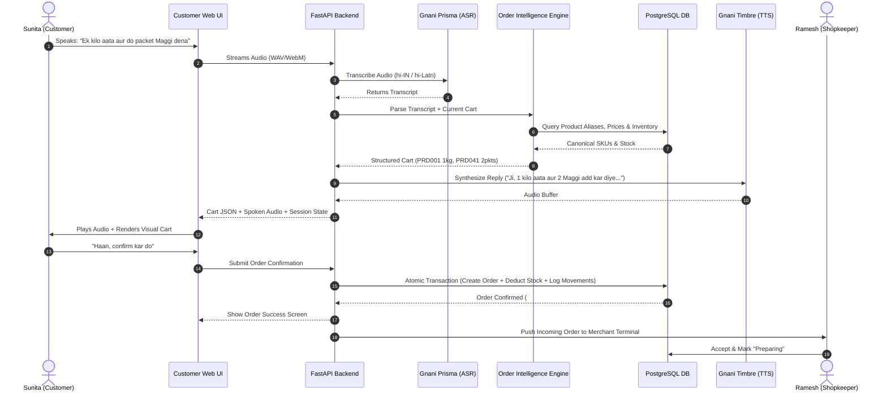
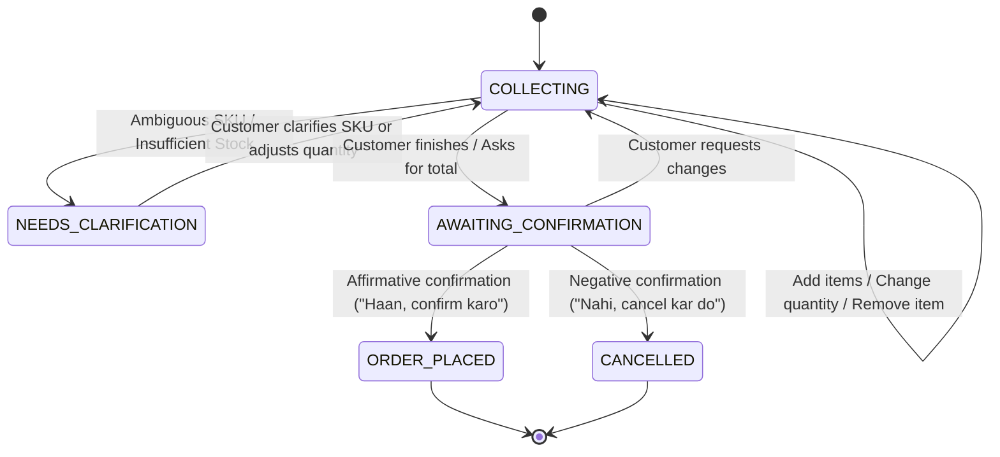
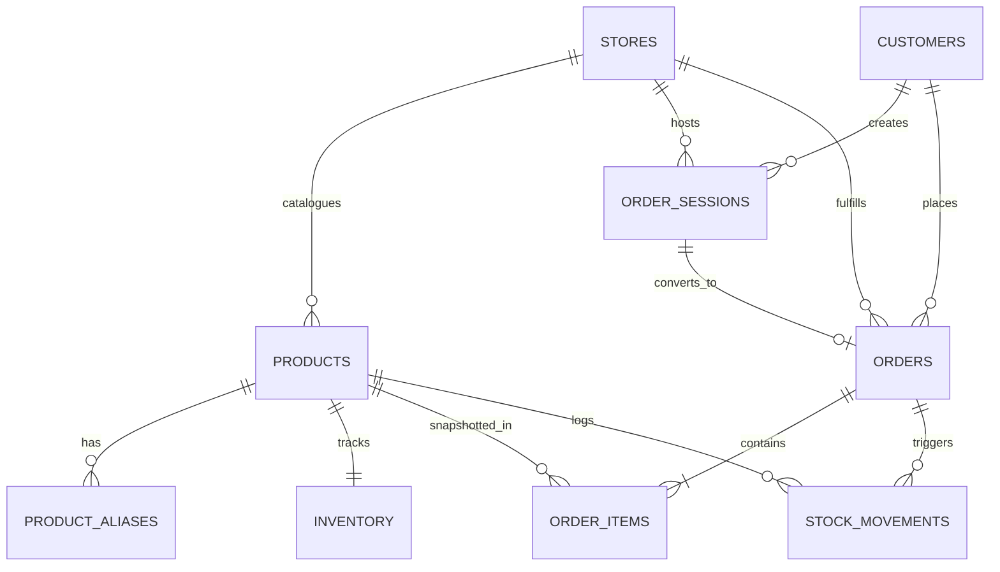

# DukaanSaathi — Product Requirements Document (PRD)

**Document Version:** 1.0.0  
**Phase:** Phase 0 — Product Discovery & Requirements  
**Status:** **FROZEN** (Sign-off: 2026-10-30)  
**Target Release:** 2026-11-09 (Internal Freeze) / 2026-11-10 (Competition Submission)  
**Product Category:** Voice-First Vernacular Commerce  
**Core Technologies:** Gnani AI (Prisma ASR + Timbre TTS), FastAPI, PostgreSQL, Next.js  

---

## 1. Executive Summary & Vision

In neighbourhood kirana stores across Bharat, millions of customers struggle with standard grocery e-commerce apps due to language barriers, unfamiliarity with text search, and the friction of typing long itemized lists on mobile keyboards. Simultaneously, kirana shopkeepers are inundated with chaotic orders scribbled in paper notebooks, fragmented WhatsApp voice notes, and phone calls, leading to stock discrepancies, missed items, and operational inefficiency.

**DukaanSaathi** is a voice-first commerce infrastructure for neighbourhood kirana stores. It allows customers to speak their grocery requirements naturally in Hindi or Hinglish, transcribes and parses spoken requests into structured cart items, clarifies ambiguities, verifies live inventory and authoritative prices in the database, and reads back order summaries using expressive synthesized speech. When confirmed, orders flow directly into the shopkeeper's live terminal for fulfilment and inventory deduction.

---

## 2. Core Engineering Principles

Every feature and architectural component must adhere strictly to these 5 foundational principles:

1. **AI should understand; the backend should control.**
   Gnani Prisma transcribes audio to text. Our order intelligence engine parses and extracts products and quantities. The database strictly validates stock and authoritative prices. Generative AI must never hallucinate prices or modify inventory tables directly.
2. **Every transaction must be reliable.**
   A customer must never have an accidental order submitted due to microphone misinterpretation or ambiguous phonemes. Confirmation must be explicit, itemized, and read back clearly.
3. **Voice is the primary interface.**
   Voice ordering is the core design paradigm from the first touchpoint, not an afterthought text chatbot with an audio recorder taped onto it.
4. **Build a complete workflow, not disconnected features.**
   The customer web app and the shopkeeper merchant management interface share the same authoritative live database state, ensuring zero ghost orders or phantom stock.
5. **Evidence over claims.**
   Order accuracy, word error rate (WER), speech generation latency, and transaction integrity will be verified against a concrete test suite of 30 benchmark cases and 5 multi-turn scenarios.

---

## 3. Problem Definition

### 3.1 Customer Problem Space
- **Typing Friction:** Typing complex grocery orders ("aadha kilo besan, do packet maggi, ek litre amul doodh") on smartphone keyboards in Hindi or Latin script is slow and error-prone.
- **Vernacular Barrier:** Standard e-commerce UIs are predominantly English-first or use unnatural machine-translated Hindi interfaces.
- **Conversational Nuance:** Customers naturally use colloquial units ("aadha kilo", "pao bhar", "ek packet", "do bottle") that standard search bars fail to parse.
- **Friction in Corrections:** When customers change their minds ("cheeni ek kilo nahi, aadha kilo kar do"), existing apps require manual cart navigation and stepper tapping.

### 3.2 Shopkeeper Problem Space
- **Fragmented Order Channels:** Shopkeepers receive orders via fragmented phone calls, physical paper chits, and unstructured WhatsApp voice notes.
- **Manual Bookkeeping & Stock Inconsistency:** Manually transcribing voice notes into ledger books leads to missed SKUs and selling out-of-stock items.
- **High Counter Load:** Peak morning and evening counter rushes make answering phone orders difficult while tending to walk-in foot traffic.
- **Lack of Lightweight Tooling:** Existing enterprise ERPs and merchant apps are overly complex and demand tedious manual data entry.

---

## 4. User Personas

### Persona A: The Vernacular Customer
- **Name:** Sunita Devi (Age 48)
- **Location:** Tier-2 / Peri-urban Bharat (e.g., Lucknow / Jaipur / Indore)
- **Profile:** Manages household groceries for a family of five. Uses an Android smartphone primarily for WhatsApp, YouTube, and UPI calls. Frequently sends WhatsApp voice notes to family members.
- **Pain Points:** Dislikes typing Hindi words with English letters; gets confused by massive infinite-scroll product catalogues; forgets items when browsing complex category trees.
- **Ideal Experience:** Opens a simple link, presses a large microphone button, speaks her grocery list in Hindi ("Bhaiya ek kilo aata aur do packet Maggi dena"), hears a polite voice read back the cart and price, and taps confirm.

### Persona B: The Kirana Shopkeeper
- **Name:** Ramesh Sharma (Age 42)
- **Business:** Owner, *Sharma General Store* (Demonstration Store `STORE001`)
- **Inventory:** ~100 fast-moving grocery and daily essential SKUs.
- **Profile:** Operates a high-footfall counter from 7:00 AM to 10:00 PM. Uses a counter tablet or smartphone.
- **Pain Points:** Loses track of customer requests sent over WhatsApp; often has to call back customers because requested brands are out of stock.
- **Ideal Experience:** Receives clear, itemized digital orders with real-time stock alerts. Can tap "Accept", prepare the bag, mark "Ready", and see stock automatically decremented without manual math.

---

## 5. End-to-End User Journeys

### 5.1 Customer Journey Details
1. **Initiation:** Customer opens store URL (e.g., `dukaansaathi.app/sharma-store`). Store status (Open/Closed) and microphone prompt appear.
2. **Spoken Request:** Customer taps the microphone and speaks naturally.
3. **Transcription & Parsing:** Audio is processed via Gnani Prisma; the backend normalizes colloquial vocabulary, identifies SKUs via alias mappings, and extracts units.
4. **Interactive Clarification (if needed):** If an utterance is ambiguous (e.g., "doodh dena" where multiple brands exist), the assistant speaks a clarification: *"Kaunsa milk chahiye: Amul Taaza ya Amul Gold?"*
5. **Cart Display & Review:** The live cart dynamically renders items, quantities, unit prices, and subtotal.
6. **Voice Correction:** Customer can amend items verbally ("Maggi hata do" or "Nahi, aadha kilo kar do") or touch-edit via UI steppers.
7. **Explicit Confirmation:** Customer confirms verbally ("Haan confirm kar do") or taps "Place Order".
8. **Feedback:** Gnani Timbre generates a polite Hindi confirmation; the screen displays the order reference and status tracker.

### 5.2 Shopkeeper Journey Details
1. **Terminal Authentication:** Shopkeeper logs into the protected merchant view (`/merchant`).
2. **Order Intake:** New orders arrive with audible chime and live status indicator (`pending`).
3. **Item Verification:** Shopkeeper views itemized quantities, brand variants, and customer notes.
4. **Action:**
   - **Accept:** Moves order to `preparing`.
   - **Reject:** If rejected, reserved stock is automatically refunded via a compensating database movement.
5. **Fulfilment:** Shopkeeper marks order as `ready` for pickup/delivery, and ultimately `completed`.
6. **Stock Management:** Shopkeeper can view low-stock alerts and adjust stock directly on the inventory tab.

---

## 6. Product Scope & Prioritization

| Feature / Capability | Priority | Rationale / Boundary |
|---|---|---|
| **Gnani Prisma STT Integration** | **P0** | Core voice input engine; handles Hindi/Hinglish speech |
| **Gnani Timbre TTS Integration** | **P0** | Spoken auditory feedback and confirmation for vernacular accessibility |
| **Deterministic Order Intelligence Engine** | **P0** | Canonical & alias product matching, unit parser, multi-item extraction |
| **Conversational State Machine** | **P0** | Manages turns: `COLLECTING`, `NEEDS_CLARIFICATION`, `AWAITING_CONFIRMATION`, `ORDER_PLACED` |
| **PostgreSQL Authoritative Database** | **P0** | ACID transactions, inventory constraint checks, historical stock movement logging |
| **Mobile-First Customer Web App** | **P0** | Clean, large-touch, audio-reactive UI with live cart and order status |
| **Shopkeeper Operations Portal** | **P0** | Order feed, accept/reject controls, inventory editor, stock status |
| **Starter Pack Demonstration Catalogue** | **P0** | 100 SKUs, 306 aliases, seeded inventory for *Sharma General Store* |
| **Multi-turn Voice Corrections** | **P0** | Verbal replacement, removal, and quantity adjustments |
| **Explicit Two-Phase Confirmation** | **P0** | Prevents accidental order submission; atomic stock deduction |
| **LLM Interpretation (Gnani Evon)** | **P1** | Complex natural language rephrasing (only after deterministic engine is verified) |
| **Product Alternative Recommendations** | **P1** | Automatic alternative suggestion when a requested SKU is out of stock |
| **Customer Order History** | **P1** | Session-based past order lookup |
| **WhatsApp Webhook Bot** | **P2** | Ingestion of voice notes directly via WhatsApp Business API |
| **Automated IVR Phone Calling** | **P2** | Dial-in ordering for feature-phone users without internet access |
| **Payment Gateway (UPI Auto-Collect)** | **P2** | In-app payment processing via Razorpay/PhonePe |
| **Multi-Store SaaS Tenancy** | **P2** | Self-serve store onboarding and multi-store catalog partitioning |

---

## 7. Functional Requirements

### FR-01: Voice Audio Ingestion & Format Handling
- The client application must capture microphone audio using the browser `MediaRecorder` API.
- Supported audio output: WAV (PCM 16kHz mono) or WebM (Opus), converted or streamed appropriately to the backend.
- Backend must validate file size (< 10 MB) and duration (< 60 seconds per turn).

### FR-02: Speech-to-Text Transcription (Gnani Prisma)
- The backend must forward validated audio to Gnani Prisma STT with target language set to Hindi (`hi-IN`) and support for code-mixed Hinglish (`hi-Latn` / `hi-en`).
- The system must capture raw transcripts and latency metrics for evaluation.

### FR-03: Transcript Normalization & Synonym Mapping
- Transcripts must be cleaned: lowercase normalization, punctuation stripping, and phonetic synonym resolution (e.g., *aata* $\rightarrow$ *atta*, *cheeni* $\rightarrow$ *sugar*, *doodh* $\rightarrow$ *milk*, *tel* $\rightarrow$ *cooking oil*).
- Both raw and normalized transcripts must be preserved in session logs for auditability.

### FR-04: Multi-Strategy Product Matching
- **Stage 1 (Exact Match):** Match against canonical product names (`name` in `products`).
- **Stage 2 (Exact Alias Match):** Match against customer-facing aliases in `product_aliases`.
- **Stage 3 (Fuzzy / Normalized Levenshtein):** Tolerant matching for minor ASR phonetic mismatches (similarity threshold $\ge 0.82$).
- **Stage 4 (Ambiguity Detection):** If a generic term (e.g., "doodh") matches multiple active SKUs (`PRD021: Amul Taaza 500ml`, `PRD022: Amul Gold 500ml`, `PRD023: Mother Dairy 500ml`), the engine must NOT arbitrarily guess. It must trigger a `NEEDS_CLARIFICATION` state with specific options.

### FR-05: Quantity and Packaging Unit Resolution
- Parse standard metric quantities: `kg`, `g`, `gram`, `litre`, `L`, `ml`.
- Parse vernacular / colloquial expressions:
  - *aadha kilo* / *half kg* $\rightarrow$ `0.5 kg`
  - *pao bhar* / *dhai sau gram* $\rightarrow$ `0.25 kg`
  - *aadha litre* $\rightarrow$ `0.5 L`
  - *ek packet* / *do dabbe* / *teen bottle* $\rightarrow$ countable units
- **Package Integrity Rule:**
  - For bulk items (`sale_unit = kg`), fractional quantities (e.g., `0.25 kg`) are directly supported.
  - For fixed package items (`sale_unit = pouch / packet / bottle`), request quantities must map to integral units. If a customer requests 250g of a fixed 1kg packaged besan, the assistant must explain: *"Besan sirf 1 kg ke packet mein uplabdh hai."*

### FR-06: Conversational Intent & State Machine
The dialogue manager enforces 5 discrete states per customer session:
1. `COLLECTING`: Customer is actively listing items. Items are added or updated in the draft cart.
2. `NEEDS_CLARIFICATION`: Triggered by ambiguous product matching, unknown quantities, or partial stock availability.
3. `AWAITING_CONFIRMATION`: Final cart read-back complete with total price; awaiting affirmative or negative response.
4. `ORDER_PLACED`: Customer has affirmatively confirmed. Transaction committed in DB.
5. `CANCELLED`: Customer explicitly aborted the order session.

### FR-07: Conversational Cart Modifications
The engine must support conversational corrections across turns:
- **Quantity override:** "Nahi, aadha kilo kar do" $\rightarrow$ replaces pending item's quantity.
- **Item removal:** "Maggi hata do" $\rightarrow$ removes product from draft cart.
- **Price inquiry:** "Aata kitne ka hai?" $\rightarrow$ reports unit price without adding to cart.
- **Stock inquiry:** "Chini hai kya?" $\rightarrow$ reports stock availability without adding to cart.
- **Clear cart:** "Poora cart saaf kar do" $\rightarrow$ empties draft cart.

### FR-08: Authoritative Inventory & Price Verification
- Draft additions check `inventory.stock_quantity`.
- If requested quantity exceeds stock (e.g. Test Case `TC016` requesting 10 jars when only 7 exist), the system must inform: *"Abhi sirf 7 jar available hain. Kya 7 add kar doon?"*
- Prices displayed and calculated must come exclusively from `products.price_inr`.

### FR-09: Atomic Two-Phase Order Confirmation
- Confirmed order commits inside an explicit PostgreSQL transaction:
  1. Verify stock availability with row-level locks (`SELECT ... FOR UPDATE`).
  2. Compute final order total snapshot.
  3. Insert into `orders` and `order_items` (preserving product name and unit price snapshot).
  4. Decrement `inventory.stock_quantity`.
  5. Insert audit records into `stock_movements` (`reason = 'customer_order'`).
  6. Mark `order_sessions.status = 'confirmed'`.

### FR-10: Spoken Feedback via Gnani Timbre TTS
- Dynamic responses generated by the dialogue engine are converted to audio via Gnani Timbre.
- Language configuration: Hindi conversational (`hi-IN`).
- Numbers and prices are properly formatted for Hindi speech (e.g. ₹145 spoken as *"ek sau paintalees rupaye"*).
- When synthesis fails, the UI must gracefully fall back to display text without blocking order progress.

### FR-11: Shopkeeper Operations Interface
- **Authentication:** Password/token-protected merchant portal.
- **Incoming Feed:** Real-time polling or WebSocket updates of incoming orders.
- **Order Lifecycle Controls:** Transitions: `pending` $\rightarrow$ `accepted` $\rightarrow$ `preparing` $\rightarrow$ `ready` $\rightarrow$ `completed`.
- **Compensating Stock Reversal:** If an accepted order is rejected/cancelled, the backend executes a compensating stock movement (`reason = 'order_rejected_restock'`) to restore inventory.
- **Inventory Editor:** Ability to adjust `stock_quantity`, toggle `is_active`, and update `price_inr`.

---

## 8. Non-Functional Requirements (NFR)

### 8.1 Performance & Latency Targets
- **Gnani Prisma STT Response Time:** $\le 1500\text{ ms}$ (p95 $\le 2500\text{ ms}$).
- **Order Intelligence Processing Time:** $\le 150\text{ ms}$ (deterministic in-memory & DB query).
- **Gnani Timbre TTS Synthesis Time:** $\le 1200\text{ ms}$.
- **Total Voice Turn Latency (Audio Upload to Playback Ready):** $\le 3500\text{ ms}$.
- **Database Query Latency:** $\le 20\text{ ms}$ for index lookups.

### 8.2 Reliability & Accuracy Acceptance Targets
- **Product Identification Accuracy:** $\ge 90\%$ on 30 benchmark test cases.
- **Quantity Extraction Accuracy:** $\ge 90\%$ on 30 benchmark test cases.
- **Exact Cart Match Rate:** $\ge 85\%$ on test suite.
- **Overselling / Stock Boundary Violations:** **$0$ occurrences** (Strict invariant).
- **Pricing Calculation Errors:** **$0$ occurrences** (Authoritative DB computation).
- **Duplicate Orders from Double-Clicks / Retries:** **$0$ occurrences** (Idempotency token enforcement).

### 8.3 Security & Credential Hygiene
- **Zero Frontend Credential Leakage:** `GNANI_API_KEY` must strictly reside in backend environment variables. The client never touches Gnani API endpoints directly.
- **Input Sanitization:** Validate and sanitize all text inputs and audio buffers to protect against injection.
- **No Persistent Voice Snooping:** Raw audio buffers stored in temporary memory only; no continuous surveillance or unconsented permanent storage.
- **Administrative Endpoint Protection:** Merchant APIs require a valid Bearer auth header (`SHOPKEEPER_AUTH_TOKEN`).

---

## 9. Data Architecture & Canonical Schema

The product architecture runs on PostgreSQL, seeded with the provided starter pack:
- Store: `STORE001` (*Sharma General Store*)
- Products: 100 SKUs (`PRD001`–`PRD100`)
- Aliases: 306 customer-facing aliases (`ALS001`–`ALS306`)
- Inventory: 100 inventory records with `low_stock_threshold`

---

## 10. Edge Case Matrix & Handling Protocols

| Scenario / Edge Case | Test Reference | Expected System Behaviour |
|---|---|---|
| **Unknown / Unlisted Product** | `TC008` ("surf excel detergent") | Inform customer politely that product is not stocked in this store; do not halt session. |
| **Ambiguous Generic Name** | `TC003` / `CONV003` ("doodh dena") | Trigger `NEEDS_CLARIFICATION`; list matching brands (*Amul Taaza, Amul Gold, Mother Dairy*). |
| **Exact Stock Boundary** | `TC015` (request 6 jars when 6 exist) | Permit addition to cart; warn low stock if threshold reached. |
| **Insufficient Stock** | `TC016` / `CONV004` (request 10 jars when 7 exist) | Explain available count (7 jars); ask customer if they want the available quantity. |
| **Fractional Packaged Request** | 250g of 1kg fixed Besan | Explain that SKU is sold as fixed 1kg packet; offer 1 packet or ask confirmation. |
| **Silent or Inaudible Audio** | Empty buffer / background hum | Prompt customer in Hindi: *"Kripya dobara boliye, hum sun nahi paye."* |
| **Timbre TTS API Timeout / Failure** | Gnani network timeout | Fallback seamlessly to displaying text transcript & cart visually without error modal. |
| **Rapid Double Tap on "Confirm"** | Network jitter / double click | Deduplicate via unique client `idempotency_key`; return existing order reference. |
| **Simultaneous Stock Contention** | Two users order final unit | Database row-lock (`FOR UPDATE`) allows first commit; second receives graceful "Sold out". |

---

## 11. Phase 0 Completion Gate & Sign-off

The following criteria have been verified and met:
- [x] Product problem space defined for both customer and shopkeeper.
- [x] Personas (Sunita Devi & Ramesh Sharma) specified.
- [x] User journeys mapped end-to-end with sequence and state diagrams.
- [x] Scope frozen: P0 deliverables separated from P1/P2.
- [x] Functional requirements (FR-01 to FR-11) detailed with exact logic rules.
- [x] Non-functional targets (latency, accuracy, zero-oversell invariant) established.
- [x] Data model reconciled with starter pack dataset and `schema_postgres.sql`.
- [x] Edge-case matrix documented.

**Phase 0 Status: FROZEN & APPROVED.**  
Proceeding to **Phase 1: Technical Feasibility & Gnani Integration**.

