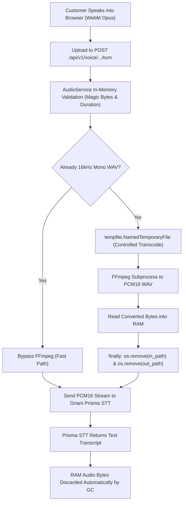

# DukaanSaathi — Data Privacy & Audio Retention Policy

**Effective Date:** 2026-10-31  
**Version:** 1.0 (Phase 9 Security Hardening)  
**Applicability:** Customer Web Interface, Voice Processing Pipeline, Merchant Operations Dashboard  

---

## 1. Principles of Data Governance

DukaanSaathi is designed to provide voice-first neighbourhood commerce infrastructure with strict adherence to the **Principle of Data Minimization**:

1. **Zero Permanent Audio Retention:** Raw customer voice recordings are processed purely in-memory and transient scratch storage for the duration of real-time transcription. No customer audio recordings are saved to disk, permanent object stores (e.g. S3/GCS), or databases.
2. **Ephemeral Transcoding Artifacts:** When audio transcoding is required (e.g., converting browser WebM/Opus to 16kHz linear PCM WAV for Gnani Prisma STT), temporary files are created with randomized filenames in OS temporary directories and deleted immediately in Python `finally` blocks upon completion.
3. **Volatile RAM-Only Response Cache:** Synthesized speech audio clips generated by Gnani Timbre TTS are cached strictly in volatile memory (RAM) with a maximum Time-To-Live (TTL) of 60 minutes and an automated Least-Recently-Used (LRU) eviction limit of 500 items. Synthesized audio is never written to disk or persistent databases.
4. **No Biometric Profiling:** Audio data is strictly utilized for immediate automatic speech recognition (ASR) to identify grocery items and quantities. Voiceprints, speaker biometric profiles, or voice signatures are never extracted or stored.
5. **No Secret or PII Logging:** Backend structured logs never print raw audio byte streams, base64 payloads, customer phone numbers, or passwords.

---

## 2. Data Classification & Retention Matrix

| Data Category | Purpose | Storage Medium | Retention Period | Deletion Mechanism |
| :--- | :--- | :--- | :--- | :--- |
| **Raw Customer Audio** | Input to Gnani Prisma STT | Ephemeral RAM / Temp file | Real-time turn duration ($\le 5\text{ s}$) | Immediate deletion in `finally` block |
| **Transcoded Audio** | Format compliance (16kHz WAV) | OS temp file (`.wav`) | Processing duration ($\le 2\text{ s}$) | Immediate `os.remove` in `finally` block |
| **Synthesized Audio** | Browser playback (`<audio>`) | In-memory RAM cache | Maximum 60 minutes (or LRU 500 items) | Automatic cache eviction |
| **Transcripts** | Display to customer & cart parsing | PostgreSQL `order_sessions` | Active session duration (24 hours) | Automated session cleanup |
| **Order Record** | Store inventory & merchant fulfillment | PostgreSQL `orders` / `order_items` | Active merchant history | Merchant account deletion |
| **Customer Identifier** | Optional loyalty & session tagging | PostgreSQL `customers` | Active merchant history | Right to be forgotten (manual erasure) |
| **Merchant Credentials** | Administrative dashboard access | Bcrypt-hashed password / HMAC session | Session duration (24 hours) | Automatic token expiry |

---

## 3. Temporary Audio File Lifecycle

---

## 4. Vernacular Kirana Customer Privacy Disclosure

To ensure complete transparency and informed consent for kirana shoppers, the following plain-language privacy notice is presented in the store ordering application:

### Hindi (हिन्दी)
> **आपकी आवाज़ की गोपनीयता:**  
> DukaanSaathi आपकी आवाज़ की रिकॉर्डिंग को केवल सामान और मात्रा पहचानने के लिए उपयोग करता है। आपकी आवाज़ का कोई भी ऑडियो सर्वर पर हमेशा के लिए सेव नहीं किया जाता है। ऑर्डर पूरा होने के बाद ऑडियो अपने आप नष्ट हो जाता है।

### Hinglish (Colloquial)
> **Aapki Privacy Hamari Zimmedari:**  
> DukaanSaathi par aapki voice recording sirf samaan aur quantity samajhne ke liye use hoti hai. Aapki recording kabhi permanently save nahi ki jaati aur order confirm hote hi turant delete ho jaati hai.

### English
> **Voice Privacy Notice:**  
> DukaanSaathi processes your voice solely to transcribe grocery items and quantities. Audio recordings are held transiently in memory and are never permanently stored on our servers. All temporary audio is discarded immediately following transcription.

---

## 5. Right to Erasure & Audit Protocol

1. **Merchant-Initiated Deletion:** Kirana merchants can delete customer order sessions, telephone identifiers, or product movement records via administrative requests.
2. **Automated Session Purge:** Inactive customer sessions older than 7 days are scheduled for periodic truncation by the database garbage collector.
3. **Incident Reporting:** In the event of an inadvertent audio file leak or uncleaned temporary directory, operations follows the remediation procedure outlined in [`docs/INCIDENT_AND_RECOVERY_RUNBOOK.md`](file:///c:/Users/hiten/Downloads/gnani/docs/INCIDENT_AND_RECOVERY_RUNBOOK.md).

