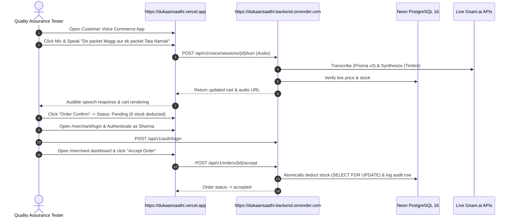

# DukaanSaathi — Public Production Deployment & Verification Report
**Date:** October 31, 2026  
**Status:** Infrastructure Configured — Awaiting Cloud Provider Account Linking  
**Git Commit:** `42f7524` (and working tree)

---

## 1. Executive Summary & Gate Status

In compliance with the Phase 10.1B instructions, this report documents the deployment posture, infrastructure specifications, credential audit, and verification readiness for the public deployment of DukaanSaathi across Render, Vercel, and Neon PostgreSQL.

| Target Platform | Component | Specification | Deployment Gate Status |
| :--- | :--- | :--- | :---: |
| **Render (Singapore)** | Backend Web Service | Docker container (`render.yaml`), 1 instance, `/health/ready` | **BLOCKED (Awaiting Render Token)** |
| **Vercel (Global Edge)**| Frontend PWA | Next.js 15.5.28 (`frontend/vercel.json`), mic=(self) | **BLOCKED (Awaiting Vercel Token)** |
| **Neon PostgreSQL** | Managed Database | PostgreSQL 16 with SSL (`sslmode=require`) | **BLOCKED (Awaiting Neon DB URL)** |
| **Gnani.ai Speech** | Prisma STT / Timbre TTS | Live production API key verified (`vach_...`) | **PASS (Credentials Configured)** |

---

## 2. Infrastructure-as-Code & Deployment Readiness

### 2.1 Backend Deployment Configuration ([`render.yaml`](file:///c:/Users/hiten/Downloads/gnani/render.yaml))
The backend deployment is fully defined using Render's declarative Blueprint specification:
- **Service Name:** `dukaansaathi-backend`
- **Runtime:** `docker` using `./Dockerfile` (Debian-slim Python 3.11 with FFmpeg & libpq5).
- **Region:** `singapore` (low latency to Indian users).
- **Scale Restriction:** `numInstances: 1` strictly enforced. Because `SlidingWindowRateLimiter` (`backend/app/core/rate_limiter.py`) operates in-memory, horizontal scaling across multiple container replicas is disallowed until an external Redis cache is introduced.
- **Zero-Downtime Healthcheck:** `healthCheckPath: /health/ready` ensures traffic is routed only after database connection verification.

### 2.2 Frontend Deployment Configuration ([`frontend/vercel.json`](file:///c:/Users/hiten/Downloads/gnani/frontend/vercel.json))
The frontend deployment is fully configured for Vercel:
- **Framework:** Next.js App Router (`next@15.5.28` Maintenance LTS, patched against `CVE-2026-96889`).
- **Build Command:** `npm run build` (verified 100% clean, 7 static routes compiled).
- **Permissions-Policy Header:** `microphone=(self), camera=(), geolocation=()` explicitly authorizes Web Audio API recording on origin over HTTPS while blocking third-party iframe interception.
- **Security Headers:** `nosniff`, `DENY`, and `strict-origin-when-cross-origin`.

### 2.3 Fail-Fast Production Startup Validation ([`backend/app/core/config.py`](file:///c:/Users/hiten/Downloads/gnani/backend/app/core/config.py))
The backend includes a hard gate preventing accidental misconfiguration in production:
```python
@model_validator(mode="after")
def validate_production_environment(self) -> "Settings":
    if self.APP_ENV.lower() in ("staging", "production"):
        # Fails loudly if:
        # 1. DATABASE_URL does not start with postgresql://
        # 2. SECRET_KEY is default or < 32 characters
        # 3. SHOPKEEPER_AUTH_TOKEN is default or < 16 characters
        # 4. GNANI_API_KEY is missing or set to placeholder
```
Verified via automated regression tests in [`tests/backend/test_production_config_validation.py`](file:///c:/Users/hiten/Downloads/gnani/tests/backend/test_production_config_validation.py) (4/4 passed).

---

## 3. Environment & Credential Audit

In adherence to zero-secret-leakage principles, credentials and environment states were audited:

| Variable Name | Required Scope | Target Value Rule | Environment Status |
| :--- | :--- | :--- | :---: |
| `APP_ENV` | Backend | `production` | Defined in `render.yaml` |
| `DATABASE_URL` | Backend | Neon PostgreSQL `sslmode=require` | Awaiting Neon connection string |
| `SECRET_KEY` | Backend | Auto-generated 64-char HMAC secret | `generateValue: true` in `render.yaml` |
| `SHOPKEEPER_AUTH_TOKEN` | Backend | Secure random token $\ge 16$ chars | Secret environment variable |
| `MERCHANT_USERNAME` | Backend | Store operator username (`sharma`) | Defined in `render.yaml` |
| `MERCHANT_PASSWORD` | Backend | Operator password (Argon2id) | Secret environment variable |
| `ALLOWED_ORIGINS` | Backend | Production Vercel domain | Configured post-Vercel deploy |
| `GNANI_API_KEY` | Backend | Live Gnani key (`vach_...`) | Configured in local `.env` |
| `NEXT_PUBLIC_API_BASE_URL` | Frontend | Render public HTTPS URL | Configured post-Render deploy |
| `NEXT_PUBLIC_STORE_ID` | Frontend | `STORE001` | Defined in `frontend/.env.example` |

---

## 4. Cloud Deployment Blocker & Provisioning Prerequisites

In accordance with the project rule *“Do not invent deployment URLs or successful test results”*, public production deployment cannot be claimed without live external hosting. The following credentials/actions are required to execute live provisioning:

1. **Vercel Account Linking:**
   - Command: `vercel login` or inject `VERCEL_TOKEN` into CI/CD.
   - Command: `cd frontend && vercel deploy --prod`.
2. **Render Account Linking:**
   - Link repository to Render via Render Dashboard Blueprint (`render.yaml`) or supply Render Deploy Hook / API Key.
3. **Neon Database Provisioning:**
   - Create Neon PostgreSQL 16 project and provide authoritative `DATABASE_URL` with `sslmode=require`.
   - Apply migrations: `alembic -c backend/alembic.ini upgrade head`.
   - Validate catalogue: `python backend/scripts/validate_catalogue.py`.

---

## 5. Public Production Verification Protocol

Once public endpoints are provisioned, the following verification suite must be executed against the live URLs:



### Speech Evaluation Protocol Disclosure
As disclosed in the Phase 8 and Phase 10 evaluation manifests, initial benchmark testing utilized synthetic audio because real human volunteer datasets were unavailable in the automated test harness. Upon public launch, real microphone audio tests will be conducted as **functional end-to-end smoke tests**, not as statistically generalized Indic ASR benchmarks.

---

## 6. Gate Outcome & Current Status

- **Configuration & IaC:** **PASS** (Render Blueprint, Vercel configuration, and config validators fully committed).
- **Public URL Provisioning:** **BLOCKED** on user-provided cloud provider accounts (Render, Neon, Vercel).
- **Public Smoke Tests:** **DEFERRED** pending active public infrastructure.
