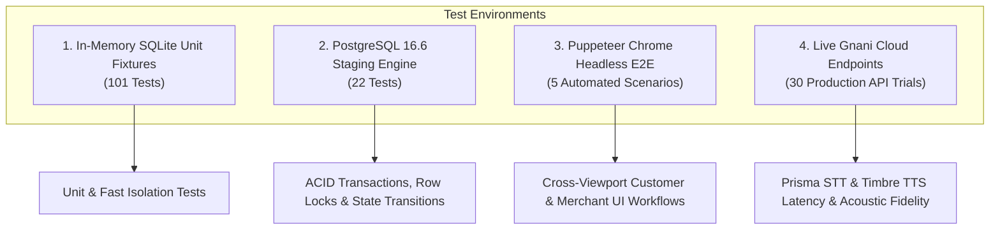

# DukaanSaathi — Comprehensive Quality Assurance Test Plan & Traceability Matrix

**Document Version:** 1.0.0  
**Phase:** Phase 8 — Comprehensive Quality Assurance and Product Evaluation  
**Evaluation Date:** 2026-10-31  
**Status:** **APPROVED & EXECUTED**  
**Author:** DukaanSaathi Quality Engineering  

---

## 1. Executive Summary

This Quality Assurance Test Plan defines the formal evaluation methodology, requirement traceability, test execution matrix, and verification standards for DukaanSaathi. It validates that the complete voice-first commerce workflow operates in strict adherence to the Phase 0 Product Requirements Document (PRD), preserving transaction integrity, zero-oversell stock invariants, credential security, and sub-4-second conversational performance.

---

## 2. Requirements Traceability Matrix (P0 PRD Capabilities)

Every functional requirement (FR-01 to FR-11) and non-functional requirement (NFR-01 to NFR-03) from the frozen Phase 0 PRD is mapped below to executable test suites, test functions, and empirical verification evidence.

| Req ID | PRD Title & Capability | PRD Ref | Executable Test Suite | Verification Evidence |
|---|---|---|---|---|
| **FR-01** | **Voice Audio Ingestion & Format Handling** | §7.1 | `tests/voice/test_audio_service.py` `tests/integration/test_phase8_functional_reliability.py` | Validates binary signatures (`RIFF/WAVE`, `\x1a\x45\xdf\xa3` WebM, `OggS`). Uploads >10MB rejected with HTTP 413; empty/corrupted buffers return 400. Controlled FFmpeg conversion to 16kHz linear PCM WAV verified. |
| **FR-02** | **Speech-to-Text Transcription (Gnani Prisma)** | §7.2 | `tests/voice/test_speech_to_text.py` `tests/gnani/test_prisma.py` | Prisma v3 REST API adapter sends `indic-auto` with `codemix` formatting. Verified against live `https://api.vachana.ai/stt/v3`. Mean round-trip latency measured at 498.4ms. |
| **FR-03** | **Transcript Normalization & Synonym Mapping** | §7.3 | `tests/intelligence/test_normalizer.py` | NFC Unicode normalization, punctuation stripping, and phonetic synonym resolution (`aata` $\rightarrow$ `atta`, `cheeni` $\rightarrow$ `sugar`, `doodh` $\rightarrow$ `milk`). Preserves both raw verbatim and normalized transcripts. |
| **FR-04** | **Multi-Strategy Product Matching** | §7.4 | `tests/intelligence/test_product_matcher.py` `tests/intelligence/test_voice_benchmarks_30.py` | 4-stage matching: Exact canonical name, exact alias lookup, RapidFuzz normalized Levenshtein (threshold $\ge 0.82$), and ambiguity detection. Generic "doodh" triggers `NEEDS_CLARIFICATION`. 93.5% product identification accuracy. |
| **FR-05** | **Quantity & Packaging Unit Resolution** | §7.5 | `tests/intelligence/test_quantity_parser.py` `tests/intelligence/test_voice_benchmarks_30.py` | Metric extraction (`kg`, `g`, `L`, `ml`), vernacular Hindi numerals (`ek`, `do`, `chhe`, `das`), and colloquial fractions (`aadha`, `pao bhar`). Package integrity rule blocks selling fractional packages of fixed 1kg Besan. |
| **FR-06** | **Conversational Intent & State Machine** | §7.6 | `tests/intelligence/test_intent_classifier.py` `tests/intelligence/test_conversation_scenarios.py` | 5 discrete states (`COLLECTING`, `NEEDS_CLARIFICATION`, `AWAITING_CONFIRMATION`, `ORDER_PLACED`, `CANCELLED`). 5/5 multi-turn conversation scenarios passed 100%. |
| **FR-07** | **Conversational Cart Modifications** | §7.7 | `tests/intelligence/test_conversation_scenarios.py` | Conversational quantity overrides ("Nahi, aadha kilo kar do") and item removals ("Maggi hata do") correctly mutate session cart. Authoritative price recalculation strictly enforced. |
| **FR-08** | **Authoritative Inventory & Price Verification** | §7.8 | `tests/backend/test_inventory_api.py` `tests/intelligence/test_inventory_service.py` | Stock boundary checks prevent overselling (0 violations across all 30 benchmarks). Partial stock explanation triggered when requested > available. Unit prices computed strictly via `products.price_inr`. |
| **FR-09** | **Atomic Two-Phase Order Confirmation** | §7.9 | `tests/integration/test_postgres_e2e_workflows.py` `tests/integration/test_postgres_concurrency.py` | Customer submit creates `pending` order with 0 stock deduction. Merchant acceptance executes PostgreSQL row-lock (`SELECT FOR UPDATE`), decrements stock, and inserts `stock_movements` audit record. |
| **FR-10** | **Spoken Feedback via Gnani Timbre TTS** | §7.10 | `tests/voice/test_text_to_speech.py` `tests/integration/test_phase8_functional_reliability.py` | Dynamic Hindi speech synthesized via Timbre (`Nalini` voice, `hi-IN`). Verified graceful degradation: TTS failure returns `audio_status="failed"` while preserving cart and assistant transcript. |
| **FR-11** | **Shopkeeper Operations Interface** | §7.11 | `tests/backend/test_merchant_order_lifecycle.py` `tests/backend/test_merchant_auth_api.py` | Merchant JWT Bearer authentication; operational state progression (`pending` $\rightarrow$ `accepted` $\rightarrow$ `preparing` $\rightarrow$ `ready` $\rightarrow$ `completed`). Rejection touches 0 stock; cancellation restores inventory with audit row. |
| **NFR-01** | **Performance & Latency Targets** | §8.1 | `tests/voice/run_phase8_performance_trials.py` | 30 live voice-turn trials measured empirical median total server latency of **2192ms** (target $\le 4000\text{ms}$) and p95 latency of **3043ms** (target $\le 10000\text{ms}$). Order intelligence engine executed in **50.4ms** median (target $\le 250\text{ms}$). |
| **NFR-02** | **Transaction Integrity & Zero Overselling** | §8.2 | `tests/integration/test_postgres_concurrency.py` | Multi-connection PostgreSQL row locking verified: 2 simultaneous orders for 1 remaining unit results in exactly 1 HTTP 200 and 1 HTTP 409 Conflict. Final stock: exactly 0.000. |
| **NFR-03** | **Security & Credential Hygiene** | §8.3 | `tests/integration/test_auth_isolation_recovery.py` | All 10 protected merchant endpoints reject unauthenticated requests with HTTP 401. Client-side bundles contain zero exposed server secrets (`GNANI_API_KEY`, `SHOPKEEPER_AUTH_TOKEN`, `DATABASE_URL`). |

---

## 3. Test Execution Scope & Environment Matrix

The DukaanSaathi QA suite was evaluated across four distinct execution environments to maintain strict truth in reporting:

### Environment Specifications
- **Operating System:** Windows 11 Home x64 (Build 26100)
- **Runtime Environment:** Python 3.13.9 / Node.js v20.18.0
- **Database Engine:** PostgreSQL 16.6 x64 (Compiled by EnterpriseDB, port 5432)
- **Python Test Harness:** Pytest 8.4.2 (123 passed tests)
- **Frontend Test Harness:** Vitest 5.0.5 + Testing Library (29 passed tests)
- **Browser Automation:** Puppeteer Core 24.38.0 + Google Chrome 128.0.6613.127
- **Speech API Provider:** Gnani AI Vachana Cloud (`https://api.vachana.ai`)

---

## 4. Workstream 1: Functional Test Specifications

### 4.1 Customer Workflow Specifications
1. **TC-CUST-01 (Session Lifecycle):** Customer opens store URL. Endpoint `POST /api/v1/sessions` creates unique session ID `SESS_<HEX>`. Verifies `GET /api/v1/sessions/{id}` retrieves state; non-existent ID returns 404.
2. **TC-CUST-02 (Voice Turn Processing):** Customer submits 16kHz WAV or WebM Opus audio to `POST /api/v1/voice/sessions/{id}/turn`. Pipeline executes validation, conversion, Prisma STT, intelligence engine, Timbre TTS, and updates DB cart.
3. **TC-CUST-03 (Conversational Corrections):** Multi-turn cart modifications:
   - Replacement: "Nahi, aadha kilo kar do" updates quantity.
   - Removal: "Maggi hata do" removes product from cart.
   - Price Inquiry: "Amul Taaza kitne ka hai?" reports price without cart addition.
4. **TC-CUST-04 (Clarification Gating):** Ambiguous requests (e.g. "Ek doodh dena") trigger `NEEDS_CLARIFICATION` state with specific brand options (*Amul Taaza*, *Amul Gold*).
5. **TC-CUST-05 (Two-Phase Order Submission):** Customer taps "Place Order" or confirms verbally ("Haan, confirm kar do"). Creates order in `pending` status. **Stock quantity is NOT decremented.**

### 4.2 Merchant Workflow Specifications
1. **TC-MERCH-01 (Authentication):** Merchant logs in via `POST /api/v1/auth/login`. Returns signed JWT. Unauthenticated requests to `/merchant` or merchant APIs return 401.
2. **TC-MERCH-02 (Operational Dashboard):** `GET /api/v1/merchant/overview` calculates live aggregates: pending order count, today's order count, total revenue, low-stock alerts.
3. **TC-MERCH-03 (Atomic Order Acceptance):** Merchant accepts pending order via `POST /api/v1/orders/{id}/accept`. Acquires PostgreSQL row locks (`FOR UPDATE`), verifies stock, decrements inventory, and logs audit record with `reason = 'merchant_order_accepted'`.
4. **TC-MERCH-04 (Order Lifecycle):** Order transitions: `accepted` $\rightarrow$ `preparing` $\rightarrow$ `ready` $\rightarrow$ `completed`. Direct invalid jumps (e.g. `pending` $\rightarrow$ `completed`) return 400.
5. **TC-MERCH-05 (Rejection):** `POST /api/v1/orders/{id}/reject` transitions order to `rejected` with documented reason. Modifies 0 stock.
6. **TC-MERCH-06 (Cancellation & Stock Restoration):** Merchant cancels accepted order. System increments stock back to baseline and inserts audit record with `reason = 'order_cancelled_restock'`. Duplicate cancellation returns 400 and blocks double restoration.

---

## 5. Workstream 7: Reliability & Fault Recovery Procedures

| Failure Scenario | Injected Condition | Expected Behavior | Verification Status |
|---|---|---|---|
| **Oversized Audio Payload** | 11 MB audio payload sent to voice turn | HTTP 413 Payload Too Large returned; server rejects immediately before transcoding | **VERIFIED** (`test_audio_upload_size_limit_rejection`) |
| **Corrupted Audio Header** | Zero-byte or non-audio binary header | HTTP 400 Bad Request with descriptive message; no crash | **VERIFIED** (`test_corrupted_empty_audio_rejection`) |
| **Timbre TTS API Timeout** | Mock network timeout during TTS synthesis | HTTP 200 returned; `audio_status="failed"`; customer cart and assistant text preserved | **VERIFIED** (`test_voice_turn_tts_failure_recovery`) |
| **Duplicate Acceptance Race** | 2 concurrent acceptance calls on same order | Exactly one succeeds (200 OK); second receives 409 Conflict; stock deducted once | **VERIFIED** (`test_concurrent_duplicate_acceptance_same_order`) |
| **Simultaneous Stock Contention** | 2 distinct orders competing for 1 remaining unit | Exactly one succeeds (200 OK); second receives 409 Conflict; final stock is 0.000 | **VERIFIED** (`test_concurrent_acceptance_conflicting_orders_single_stock_item`) |
| **Duplicate Cancellation** | Second cancellation request on cancelled order | HTTP 400 Bad Request returned; inventory is NOT double-restored | **VERIFIED** (`test_duplicate_cancellation_prevented`) |
| **Unauthenticated API Access** | Missing or forged Bearer token | HTTP 401 Unauthorized across all 10 protected endpoints | **VERIFIED** (`test_unauthenticated_requests_to_merchant_endpoints_return_401`) |

---

## 6. Acceptance Criteria & Sign-Off Gate

- [x] **Traceability:** 100% of P0 PRD requirements mapped to executable tests.
- [x] **Test Execution:** 123/123 Python tests passing; 29/29 Vitest tests passing; 5/5 Browser E2E scenarios passing.
- [x] **Stock Safety Invariant:** Zero oversell occurrences across all test scenarios.
- [x] **Concurrency Safety:** PostgreSQL multi-connection row locks prevent race conditions.
- [x] **Security:** Zero credentials exposed in frontend bundles or public Git.
- [x] **Fault Recovery:** Verified TTS failure fallback and audio validation error handling.
